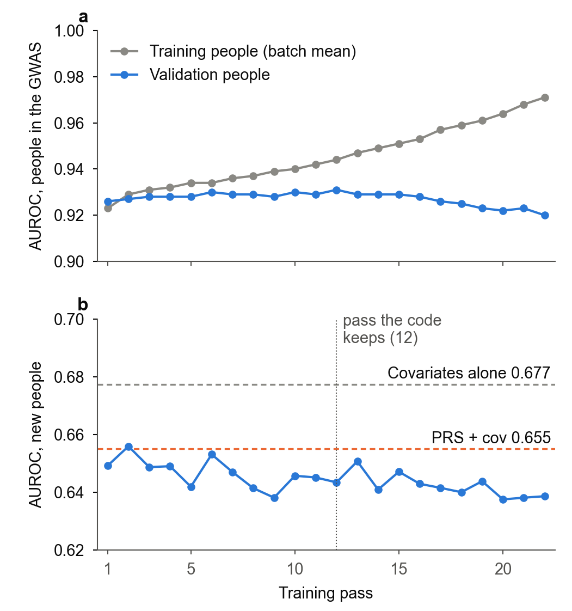
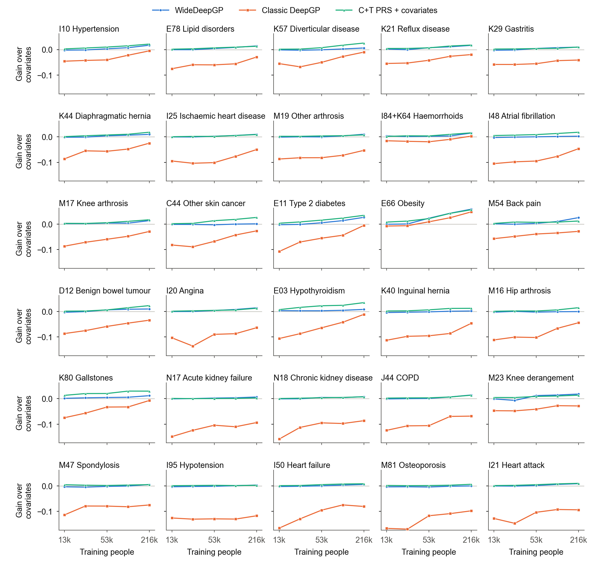

# DeepGP on type 2 diabetes: our replication, and DeepGP across five training sizes

*UK Biobank, application 15181. Compiled 26 November 2026. Aggregate results only. Code, tables and figure data:
DeepWideGP-Scripts, branch `widening`, `scripts/deepgp-summary/`.*

We reran the published DeepGP code on UK Biobank to reproduce the paper's type 2 diabetes (T2D) result, using two
1:1 case-control sets built from E11: one with random controls and one with controls matched on age and sex.

## In short

- **1:1 random controls with risk-allele dosages reproduce the paper's DeepGP:** 0.648–0.652 against its 0.64.
    - With minor-allele dosages, as the paper states, DeepGP learns nothing with matched controls (0.500) and scores
    0.625 with random controls.
    - With matched controls and risk-allele dosages it reaches 0.615.
- **Our PRS + covariates baseline is higher than the paper's.** It scores 0.655–0.659 with random controls, against
  the paper's 0.60.
- **Small GWAS overfit.** With 34,690 people in the GWAS, every PRS scores 0.95–1.00 on those people and 0.56–0.62 on
  new people.
    - The paper's way of adding covariates then gives the PRS 6–12 times the weight that new people support.
    - DeepGP, whose SNPs come from the same GWAS, scores 0.99 on the GWAS people and 0.65 on new people.

## 1. Our replication sets against the paper's

### Table 1. How our two E11 sets compare with the paper's T2D set

| Feature | Paper (T2D, 1:1) | Ours: 1:1, random controls | Ours: 1:1, controls matched on age and sex |
|---|---|---|---|
| Outcome | T2D from self-report, medication, HbA1c ≥ 6.5%, ICD-9 250 and ICD-10 E10–E14; type 1 excluded | E11 from hospital inpatient and death records | E11 from hospital inpatient and death records |
| Population | European UK Biobank participants | Unrelated White British; withdrawn participants removed | Unrelated White British; withdrawn participants removed |
| Training people (cases) | 44,828 (22,414) | 34,690 (17,345) | 34,690 (17,345) |
| Test people (cases) | 7,912 (3,956) | 3,326 (1,663), from our tuning set; our main test set stays locked | 3,326 (1,663), the same cases as the random set |
| 1:1 cases and controls, training and test | Yes; what controls were matched on is not stated | Yes; controls drawn at random | Yes; each control matched exactly on sex and year of age |
| People in the GWAS | The training set | (a) The set's own 34,690 training people; (b) all 215,872 of our training people | All 215,872 of our training people |
| GWAS fitted on training people only, not validation? | No: its validation folds sat inside the GWAS (the paper's limitations) | No: the code's 15% validation part sits inside the GWAS. Test people are outside | No: the same. Test people are outside |
| SNPs in the GWAS | 13.3 million imputed | (a) 7,813,490 imputed; (b) 1,258,200 HapMap3+ | 1,258,200 HapMap3+ |
| GWAS software and covariates | PLINK 2 logistic regression; sex, age, PC1–6 | (a) The paper's own PLINK script, unchanged; (b) REGENIE with birth year, sex, PC1–10 | REGENIE with birth year, sex, PC1–10 |
| Clumping | p ≤ 0.05, r² 0.7, 500 kb | Same | Same |
| Lead SNPs given to DeepGP and the PRS | About 100,000 | (a) 98,440; (b) 47,341 | 47,341 |
| Dosages count | The minor allele (as stated) | Minor allele, and separately the risk allele | Minor allele, and separately the risk allele |
| Covariates in DeepGP and the PRS model | Age, sex, PC1–6 | Same | Same |
| Code and settings | Published code; T2D settings chosen by five-fold cross-validation | Published code (commit 48e841d) and its T2D settings, as given | Same as the random set |
| People used for early stopping | Five-fold cross-validation inside the training set | A random 15% of the training people | A random 15% of the training people |

(a) is our most faithful replication; (b) is the GWAS used for the minor-allele run and the first risk-allele run.

## 2. Results

### Table 2. DeepGP and its comparators on the test people

| Run | DeepGP AUROC | PRS + covariates (paper's recipe, same training people) | PRS alone | Covariates alone |
|---|---|---|---|---|
| **1. Paper: DeepGP, 1:1 (matching not stated)** | **0.64** | **0.60** | not reported | not reported |
| 2. DeepGP, minor-allele dosages, 1:1 random controls; GWAS of 215,872 | 0.625 (0.605–0.644) | 0.655 (0.636–0.675) | 0.602 (0.583–0.623) | 0.677 (0.659–0.695) |
| 3. DeepGP, risk-allele dosages, 1:1 random controls; GWAS of 215,872 | 0.652 (0.633–0.673) | 0.655 (0.636–0.675) | 0.602 (0.583–0.623) | 0.677 (0.659–0.695) |
| **3b. DeepGP, risk-allele dosages, 1:1 random controls; the set's own GWAS (most faithful)** | **0.648 (0.629–0.666)** | **0.659 (0.642–0.679)** | **0.578 (0.560–0.599)** | **0.677 (0.659–0.695)** |
| 4. DeepGP, risk-allele dosages, 1:1 matched on age and sex; GWAS of 215,872 | 0.615 (0.596–0.634) | 0.618 (0.600–0.638) | 0.618 (0.599–0.637) | 0.519 (0.498–0.539) |
| 4b. DeepGP, minor-allele dosages, 1:1 matched on age and sex; GWAS of 215,872 | 0.500 (0.480–0.518) | 0.618 (0.600–0.638) | 0.618 (0.599–0.637) | 0.519 (0.498–0.539) |

How to read this table:

- **The people scored.** Every AUROC is on the test people, who are outside every GWAS; in brackets is the 95%
  bootstrap interval. They come from our tuning set, the table our code calls "validation". Table 3 gives the code's
  own validation part, which sits inside the GWAS.
- **The PRS.** It is the paper's C+T score from the same lead SNPs: log odds ratio × dosage, summed. "PRS +
  covariates" is the paper's recipe, a logistic regression fitted on the same training people as DeepGP.
- **Matched controls** remove the age and sex signal (covariates alone 0.519), so everything above 0.5 in rows 4 and 4b
  is genetic.
- **Population prevalence**, for reference: the paper reports DeepGP 0.673 and PRS + covariates 0.640. Ours, with
  risk-allele dosages on all 215,872 training people, scores 0.665 on our tuning set, against 0.670 for covariates
  alone.

## 3. Small GWAS overfit

### Table 3. AUROC inside and outside the GWAS (the random set's own GWAS of 34,690 people)

| Model | Training part (in the GWAS; 29,486) | Validation part (in the GWAS; 5,204) | Test people (not in the GWAS; 3,326) |
|---|---|---|---|
| C+T PRS alone | 0.984 | 0.983 | 0.578 |
| C+T PRS + covariates (paper's recipe) | 0.995 | 0.995 | 0.659 |
| LDpred2-auto alone | 0.950 | 0.950 | 0.621 |
| LDpred2-auto + covariates (recipe) | 0.970 | 0.971 | 0.686 |
| lassosum2 alone (penalty chosen on the validation part) | 0.999 | 0.999 | 0.563 |
| lassosum2 + covariates (recipe) | 1.000 | 1.000 | 0.657 |
| **DeepGP, risk allele, after one pass** | 0.993 | 0.990 | 0.646 |
| **DeepGP, risk allele, trained to completion (stopped at pass 25; pass 15 kept)** | 0.995\* | 0.992\* | 0.648 |
| Covariates alone | 0.652 | 0.659 | 0.678 |

\* From the training log, averaged over batches of 64. The other DeepGP numbers score each whole part.

- **Covariates alone** score about the same everywhere (0.65–0.68). Every genetic model scores 0.95–1.00 inside the
  GWAS and 0.56–0.69 outside it.
- **DeepGP after one pass already matches DeepGP trained to completion** on new people (0.646 against 0.648). The rest
  of training raises it only inside the GWAS.
- **LDpred2-auto and lassosum2** use a GWAS of the same people on HapMap3+ SNPs, fitted with our PGI arm's code.
  lassosum2's penalty was chosen on the validation part, as the code would.

### Table 4. Does a larger SNP pool worsen the overfitting?

The paper's GWAS tested 13.3 million SNPs; ours tested 1.26 million (HapMap3+) or 7.8 million (all imputed).

| Run | People in the GWAS | SNPs in the GWAS | Lead SNPs in the PRS | Validation part (in the GWAS) | Test people (not in the GWAS) |
|---|---|---|---|---|---|
| PRS + cov, HapMap3+ GWAS | 215,872 | 1,258,200 | 47,341 | 0.930 | 0.655 |
| PRS only, HapMap3+ GWAS | 215,872 | 1,258,200 | 47,341 | 0.915 | 0.602 |
| PRS + cov, all-SNP GWAS | 34,690 | 7,813,490 | 98,440 | 0.995 | 0.659 |
| PRS only, all-SNP GWAS | 34,690 | 7,813,490 | 98,440 | 0.983 | 0.578 |
| PRS + cov, all-SNP GWAS, random 5% of the lead SNPs | 34,690 | 7,813,490 | 4,932 | 0.902 | 0.621 |
| PRS + cov, all-SNP GWAS, random 10% of the lead SNPs | 34,690 | 7,813,490 | 9,718 | 0.946 | 0.628 |
| PRS + cov, all-SNP GWAS, random 25% of the lead SNPs | 34,690 | 7,813,490 | 24,963 | 0.979 | 0.642 |
| PRS + cov, all-SNP GWAS, random 50% of the lead SNPs | 34,690 | 7,813,490 | 49,058 | 0.990 | 0.653 |
| PRS + cov, all-SNP GWAS, random 75% of the lead SNPs | 34,690 | 7,813,490 | 73,824 | 0.994 | 0.657 |

- **The first four rows differ in two ways at once.** The all-SNP GWAS tested six times as many SNPs, but on a sixth as
  many people (34,690 against 215,872). Its PRS overfits more (0.983 against 0.916 on the validation part) and does
  worse alone on new people (0.578 against 0.602). This table cannot say which of the two differences did it.
- **The subset rows hold the GWAS fixed and vary only the number of lead SNPs.**
    - More SNPs widen the gap between inside and outside the GWAS (0.902 → 0.621 with 5% of the SNPs; 0.995 → 0.659
    with all of them).
    - But on new people the PRS + covariates gets better, not worse (0.621 → 0.659).
    - The PRS's over-weighting stays at 11–12× throughout.
- **So, on our data, a bigger SNP pool makes the PRS look better inside the GWAS without making it worse on new
  people.** A smaller GWAS does make it worse.
    - The paper's 13.3 million SNPs also gave about as many lead SNPs (about 100,000) as our 7.8 million (98,440).
    - So its larger SNP pool alone is unlikely to explain its 0.60.
- **A clean test would hold the people fixed:** a C+T score from a HapMap3+ GWAS of the same 34,690 people. Those GWAS
  summary statistics exist but were never clumped and scored.

<figure markdown="1">

<figcaption><strong>Figure 1. Validation inside the GWAS cannot see the overfitting, and more training does not help
on new people.</strong> Risk-allele DeepGP on the 1:1 random-controls set (GWAS of 215,872 people), rerun with the
test people scored after every pass. <strong>a</strong>, AUROC on training and validation people, both inside the
GWAS. <strong>b</strong>, AUROC on the test people, with the pass the code keeps, covariates alone and PRS + cov (the
paper's recipe). Scoring the test people changed nothing in training and chose nothing. Data:
<code>figures/training_passes.csv</code>.</figcaption>
</figure>

### How we measured the PRS over-weighting and the covariates' share of the score

- **PRS over-weighting.**
    - We fit the paper's recipe twice: a logistic regression of the outcome on the PRS, sex, age and PC1–6, with every
    input standardised by the training people's mean and SD (scikit-learn defaults).
    - The first fit uses the training people, as the paper does; they are all inside the GWAS. The second fit uses the
    test people, who are outside it.
    - The over-weighting is the PRS's coefficient in the first fit divided by its coefficient in the second.
    - Results:
      - C+T from the set's own GWAS (34,690 people): 6.99 against 0.59, so **11.8×**.
      - C+T from the GWAS of 215,872 people: 2.86 against 0.52, so **5.5×**.
      - LDpred2-auto from the set's own HapMap3+ GWAS: **5.8×**.
- **Covariates' share of the score.**
    - For each fit we compute every test person's score (the regression's linear predictor) and its covariate part (the
    same sum without the PRS term).
    - The share is the variance of the covariate part divided by the variance of the whole score, across the test
    people.
    - The recipe leaves the covariates 28% of the score (12% with the GWAS of 215,872). A fit on the test people gives
    them 83% (73%). LDpred2-auto: 21% against 67%.
    - The recipe's score is mostly PRS, and on new people the PRS is the weaker of the two.
- **Note: the overfitting is even worse at our smallest training size (13,199 people).** There, LDpred2-auto scores
  0.997–1.000 on its own training people and 0.52–0.53 on new people, for hypertension (I10), diverticular disease (K57)
  and atrial fibrillation (I48). E11 was not measured at that size.

## 4. Five training sizes, 30 diseases (our main study, separate from the replication)

The comparison setup:

- **Data.** Real UK Biobank labels for 30 diseases. Training sizes 13,199 to 215,872 people. The same 20,000 tuning
  people for every model and size.
- **How each AUROC is read.** At each model's best check on the tuning set, so every number is mildly optimistic.
- **Classic DeepGP** is the published network with what the replication taught:
    - risk-allele dosages;
    - the paper's SNP rule applied to each size's own GWAS;
    - the T2D settings for every disease, half-case batches and one seed.
- **WideDeepGP** is the mean of three seeds.
- **C+T** is our PGI arm's clumping-and-thresholding PRS. It is joined to the covariates by a logistic regression
  fitted on the tuning people, our shared comparison rule. Its own covariates-only fit gives 0.6653, so compare gains
  over covariates rather than raw AUROCs.

### Table 5. Mean tuning AUROC over the 30 diseases (gain over covariates alone in brackets)

| Training people | Covariates alone | Classic DeepGP | WideDeepGP (3 seeds, mean ± SD) | Ridge PRS + covariates (WideDeepGP's linear twin) | C+T PRS + covariates (own covariates 0.6653) | Classic above covariates | WideDeepGP above covariates |
|---|---|---|---|---|---|---|---|
| 13,199 | 0.6598 | 0.5667 (−0.093) | 0.6587 ± 0.0002 (−0.001) | 0.6611 (+0.001) | 0.6680 (+0.003) | 0 of 30 | 6 of 30 |
| 26,287 | 0.6613 | 0.5772 (−0.084) | 0.6604 ± 0.0004 (−0.001) | 0.6638 (+0.002) | 0.6697 (+0.004) | 0 of 30 | 7 of 30 |
| 53,498 | 0.6620 | 0.5910 (−0.071) | 0.6648 ± 0.0006 (+0.003) | 0.6670 (+0.005) | 0.6724 (+0.007) | 1 of 30 | 22 of 30 |
| 107,743 | 0.6625 | 0.6039 (−0.059) | 0.6688 ± 0.0003 (+0.006) | 0.6718 (+0.009) | 0.6768 (+0.011) | 1 of 30 | 26 of 30 |
| 215,872 | 0.6627 | 0.6204 (−0.042) | 0.6743 ± 0.0006 (+0.012) | 0.6777 (+0.015) | 0.6819 (+0.017) | 2 of 30 | 28 of 30 |

- **Classic DeepGP is below covariates alone for 28–30 of the 30 diseases at every size.**
- **Like for like, it matches the replication.** The top-size E11 model, scored on the replication's 3,326 test
  people, gives 0.656, against 0.652 for the replication run (covariates alone 0.679 and 0.677).
- **The lower numbers here come from three things:**
    - smaller GWAS at the smaller sizes (E11 falls from 0.665 to 0.561);
    - diseases that age and sex predict well, such as hypotension (0.574 against 0.691 for covariates alone);
    - possibly the half-case batches, which is untested. They show each case many times at small sizes (about 85 times
    for the kept model at 13,199), and there the network gives most new people near-certain scores.
- **WideDeepGP beats classic DeepGP for all 30 diseases at every size.**
    - It beats covariates alone from 53,498 people up.
    - It stays below the C+T and ridge PRS + covariates. At the top size it reaches 70% of C+T's gain over covariates
    (0.0116 against 0.0165).

<figure markdown="1">

<figcaption><strong>Figure 2. Mean gain over covariates alone, by training size.</strong> Tuning AUROC minus
covariates alone, averaged over 30 diseases. C+T is measured against its own covariates-only fit on the tuning set.
Data: <code>figures/ladder_means.csv</code>.</figcaption>
</figure>

<figure markdown="1">

<figcaption><strong>Figure 3. The same, disease by disease.</strong> One panel per disease, ordered by number of
cases. The y axis is shared across panels. Data: <code>figures/ladder_per_disease.csv</code>.</figcaption>
</figure>

### How WideDeepGP differs from classic DeepGP

- **Which SNPs.**
    - Classic: one model per disease, on the 30,000–58,000 lead SNPs that disease's GWAS picks (p ≤ 0.05, clumped at
    r² 0.7 within 500 kb). Each SNP counts its risk allele.
    - WideDeepGP: one model for all 30 diseases, on all 1,258,200 HapMap3+ SNPs, with no selection.
- **First layer: what a SNP contributes.**
    - Classic: every SNP on a chromosome passes through the same small filter, three neighbouring SNPs at a time. SNPs
    are told apart only by a fixed code for their base-pair position, so no SNP has a weight of its own.
    - WideDeepGP: every SNP has its own 32 numbers, taken from a ridge regression of all 30 diseases on the SNPs (the
    "30-disease ridge"):
      - the ridge is fitted within each LD block, on the disease labels with the covariates' linear effect removed;
      - 30 diseases × 3 penalties give 90 weights per SNP, compressed to 32;
      - it is cross-fitted: five copies, each fitted without one fifth of the training people, and each person is scored
      by a copy that never saw them;
      - the layer is fixed, not trained.
- **Grouping.**
    - Classic: SNPs are grouped by chromosome, and each chromosome's SNPs are averaged into one vector.
    - WideDeepGP: each person's dosages times their SNPs' numbers are summed within each of the 431 LD blocks of Privé et
    al. That gives one vector of 32 numbers per block, plus a learned label for each block and chromosome.
- **Mixer.**
    - Classic: a Mamba (state-space) layer runs along each chromosome's SNPs, then attention runs across the 22
    chromosome vectors and a covariate vector.
    - WideDeepGP: a small transformer (two layers, width 32, four heads) lets the 431 block vectors and a covariate token
    attend to one another.
- **Output.**
    - Classic: one output, for one disease.
    - WideDeepGP: the average of the tokens, beside the covariates, goes into a shared layer of 256. A small head per
    disease then gives 30 outputs.
- **Training.**
    - Classic: the paper's T2D settings for every disease, with half-case batches.
    - WideDeepGP: shuffled batches at population prevalence, with each disease's loss scaled by its prevalence. One
    setting, chosen at the top size, is used for all sizes.
    - Trained parameters: about 0.46 million per disease for classic DeepGP, and 0.32 million for WideDeepGP (plus a
    fixed table of 201 million numbers).

## Questions for the authors

- Which allele did the dosages count?
- How were the 1:1 controls chosen: at random, or matched on something?
- Was the balanced analysis's GWAS run on the balanced training set?
- How was the PRS + covariates baseline fitted? Fitted on the GWAS people, ours gives 0.659 with random controls, not
  0.60.
- Was the reported model one network, one fold's network, or an average of five?
- What is the covariates-only AUROC for T2D? Supplementary Figure 6 does not label the diseases.

## Appendix. Table 6: tuning AUROC per disease, at each training size

Columns:

- **Covariates alone**: the logistic regression fitted on the training people, the floor for both DeepGP models.
- **C+T + covariates** and its **own covariates**: both fitted on the tuning people.
- **Cases**: tuning-set cases. WideDeepGP is the mean of seeds 1–3.

215,872 training people

| Disease | Cases | Covariates alone | Classic DeepGP | WideDeepGP | C+T + covariates | C+T's own covariates |
|---|---|---|---|---|---|---|
| I10 Hypertension | 6,255 | 0.699 | 0.694 | 0.716 | 0.721 | 0.699 |
| E78 Lipid disorders | 3,153 | 0.691 | 0.662 | 0.705 | 0.705 | 0.692 |
| K57 Diverticular disease | 2,784 | 0.626 | 0.616 | 0.632 | 0.653 | 0.627 |
| K21 Reflux disease | 2,387 | 0.589 | 0.570 | 0.606 | 0.610 | 0.592 |
| K29 Gastritis | 2,238 | 0.603 | 0.561 | 0.612 | 0.614 | 0.604 |
| K44 Diaphragmatic hernia | 2,271 | 0.615 | 0.590 | 0.624 | 0.636 | 0.619 |
| I25 Ischaemic heart disease | 2,126 | 0.731 | 0.681 | 0.741 | 0.742 | 0.733 |
| M19 Other arthrosis | 1,966 | 0.660 | 0.607 | 0.670 | 0.669 | 0.662 |
| I84+K64 Haemorrhoids | 1,962 | 0.537 | 0.540 | 0.552 | 0.565 | 0.549 |
| I48 Atrial fibrillation | 1,670 | 0.747 | 0.701 | 0.750 | 0.766 | 0.748 |
| M17 Knee arthrosis | 1,675 | 0.629 | 0.600 | 0.642 | 0.648 | 0.631 |
| C44 Other skin cancer | 1,676 | 0.667 | 0.641 | 0.668 | 0.695 | 0.668 |
| E11 Type 2 diabetes | 1,663 | 0.670 | 0.664 | 0.696 | 0.705 | 0.671 |
| E66 Obesity | 1,478 | 0.550 | 0.598 | 0.608 | 0.612 | 0.556 |
| M54 Back pain | 1,310 | 0.588 | 0.559 | 0.613 | 0.602 | 0.590 |
| D12 Benign bowel tumour | 1,309 | 0.620 | 0.586 | 0.629 | 0.644 | 0.622 |
| I20 Angina | 1,284 | 0.704 | 0.640 | 0.718 | 0.718 | 0.706 |
| E03 Hypothyroidism | 1,211 | 0.679 | 0.667 | 0.687 | 0.716 | 0.682 |
| K40 Inguinal hernia | 1,140 | 0.779 | 0.732 | 0.780 | 0.793 | 0.781 |
| M16 Hip arthrosis | 1,106 | 0.660 | 0.615 | 0.659 | 0.675 | 0.661 |
| K80 Gallstones | 1,118 | 0.609 | 0.602 | 0.621 | 0.642 | 0.612 |
| N17 Acute kidney failure | 1,007 | 0.699 | 0.605 | 0.705 | 0.703 | 0.700 |
| N18 Chronic kidney disease | 943 | 0.724 | 0.637 | 0.732 | 0.733 | 0.726 |
| J44 COPD | 986 | 0.688 | 0.620 | 0.703 | 0.704 | 0.691 |
| M23 Knee derangement | 872 | 0.571 | 0.543 | 0.589 | 0.593 | 0.580 |
| M47 Spondylosis | 797 | 0.642 | 0.568 | 0.648 | 0.651 | 0.646 |
| I95 Hypotension | 834 | 0.691 | 0.574 | 0.694 | 0.694 | 0.692 |
| I50 Heart failure | 814 | 0.721 | 0.641 | 0.727 | 0.731 | 0.723 |
| M81 Osteoporosis | 840 | 0.761 | 0.663 | 0.761 | 0.769 | 0.763 |
| I21 Heart attack | 730 | 0.732 | 0.638 | 0.741 | 0.745 | 0.735 |
| **Mean** |  | **0.663** | **0.620** | **0.674** | **0.682** | **0.665** |

107,743 training people

| Disease | Cases | Covariates alone | Classic DeepGP | WideDeepGP | C+T + covariates | C+T's own covariates |
|---|---|---|---|---|---|---|
| I10 Hypertension | 6,255 | 0.699 | 0.677 | 0.706 | 0.714 | 0.699 |
| E78 Lipid disorders | 3,153 | 0.691 | 0.635 | 0.700 | 0.702 | 0.692 |
| K57 Diverticular disease | 2,784 | 0.626 | 0.599 | 0.628 | 0.644 | 0.627 |
| K21 Reflux disease | 2,387 | 0.590 | 0.563 | 0.601 | 0.606 | 0.592 |
| K29 Gastritis | 2,238 | 0.602 | 0.559 | 0.610 | 0.609 | 0.604 |
| K44 Diaphragmatic hernia | 2,271 | 0.615 | 0.567 | 0.622 | 0.629 | 0.619 |
| I25 Ischaemic heart disease | 2,126 | 0.731 | 0.655 | 0.737 | 0.738 | 0.733 |
| M19 Other arthrosis | 1,966 | 0.660 | 0.587 | 0.663 | 0.666 | 0.662 |
| I84+K64 Haemorrhoids | 1,962 | 0.536 | 0.526 | 0.539 | 0.559 | 0.549 |
| I48 Atrial fibrillation | 1,670 | 0.747 | 0.670 | 0.749 | 0.761 | 0.748 |
| M17 Knee arthrosis | 1,675 | 0.629 | 0.581 | 0.633 | 0.642 | 0.631 |
| C44 Other skin cancer | 1,676 | 0.667 | 0.625 | 0.667 | 0.687 | 0.668 |
| E11 Type 2 diabetes | 1,663 | 0.670 | 0.626 | 0.683 | 0.695 | 0.671 |
| E66 Obesity | 1,478 | 0.546 | 0.572 | 0.589 | 0.598 | 0.556 |
| M54 Back pain | 1,310 | 0.588 | 0.554 | 0.599 | 0.597 | 0.590 |
| D12 Benign bowel tumour | 1,309 | 0.620 | 0.574 | 0.628 | 0.636 | 0.622 |
| I20 Angina | 1,284 | 0.705 | 0.617 | 0.712 | 0.712 | 0.706 |
| E03 Hypothyroidism | 1,211 | 0.678 | 0.636 | 0.683 | 0.706 | 0.682 |
| K40 Inguinal hernia | 1,140 | 0.779 | 0.692 | 0.779 | 0.793 | 0.781 |
| M16 Hip arthrosis | 1,106 | 0.659 | 0.593 | 0.658 | 0.667 | 0.661 |
| K80 Gallstones | 1,118 | 0.609 | 0.576 | 0.614 | 0.642 | 0.612 |
| N17 Acute kidney failure | 1,007 | 0.699 | 0.588 | 0.702 | 0.701 | 0.700 |
| N18 Chronic kidney disease | 943 | 0.723 | 0.625 | 0.727 | 0.731 | 0.726 |
| J44 COPD | 986 | 0.689 | 0.619 | 0.695 | 0.697 | 0.691 |
| M23 Knee derangement | 872 | 0.571 | 0.544 | 0.586 | 0.590 | 0.580 |
| M47 Spondylosis | 797 | 0.643 | 0.561 | 0.642 | 0.650 | 0.646 |
| I95 Hypotension | 834 | 0.691 | 0.561 | 0.692 | 0.693 | 0.692 |
| I50 Heart failure | 814 | 0.722 | 0.647 | 0.725 | 0.730 | 0.723 |
| M81 Osteoporosis | 840 | 0.760 | 0.651 | 0.759 | 0.766 | 0.763 |
| I21 Heart attack | 730 | 0.731 | 0.638 | 0.737 | 0.743 | 0.735 |
| **Mean** |  | **0.662** | **0.604** | **0.669** | **0.677** | **0.665** |

53,498 training people

| Disease | Cases | Covariates alone | Classic DeepGP | WideDeepGP | C+T + covariates | C+T's own covariates |
|---|---|---|---|---|---|---|
| I10 Hypertension | 6,255 | 0.699 | 0.658 | 0.702 | 0.709 | 0.699 |
| E78 Lipid disorders | 3,153 | 0.691 | 0.631 | 0.695 | 0.699 | 0.692 |
| K57 Diverticular disease | 2,784 | 0.626 | 0.576 | 0.625 | 0.634 | 0.627 |
| K21 Reflux disease | 2,387 | 0.590 | 0.548 | 0.597 | 0.599 | 0.592 |
| K29 Gastritis | 2,238 | 0.602 | 0.546 | 0.606 | 0.608 | 0.604 |
| K44 Diaphragmatic hernia | 2,271 | 0.615 | 0.558 | 0.619 | 0.626 | 0.619 |
| I25 Ischaemic heart disease | 2,126 | 0.731 | 0.630 | 0.733 | 0.735 | 0.733 |
| M19 Other arthrosis | 1,966 | 0.659 | 0.578 | 0.659 | 0.665 | 0.662 |
| I84+K64 Haemorrhoids | 1,962 | 0.536 | 0.517 | 0.538 | 0.552 | 0.549 |
| I48 Atrial fibrillation | 1,670 | 0.747 | 0.651 | 0.747 | 0.757 | 0.748 |
| M17 Knee arthrosis | 1,675 | 0.628 | 0.569 | 0.632 | 0.636 | 0.631 |
| C44 Other skin cancer | 1,676 | 0.667 | 0.599 | 0.664 | 0.682 | 0.668 |
| E11 Type 2 diabetes | 1,663 | 0.669 | 0.614 | 0.674 | 0.686 | 0.671 |
| E66 Obesity | 1,478 | 0.545 | 0.554 | 0.568 | 0.577 | 0.556 |
| M54 Back pain | 1,310 | 0.587 | 0.548 | 0.590 | 0.596 | 0.590 |
| D12 Benign bowel tumour | 1,309 | 0.619 | 0.560 | 0.625 | 0.627 | 0.622 |
| I20 Angina | 1,284 | 0.704 | 0.614 | 0.707 | 0.710 | 0.706 |
| E03 Hypothyroidism | 1,211 | 0.678 | 0.614 | 0.681 | 0.704 | 0.682 |
| K40 Inguinal hernia | 1,140 | 0.778 | 0.682 | 0.776 | 0.787 | 0.781 |
| M16 Hip arthrosis | 1,106 | 0.658 | 0.555 | 0.655 | 0.662 | 0.661 |
| K80 Gallstones | 1,118 | 0.606 | 0.573 | 0.611 | 0.632 | 0.612 |
| N17 Acute kidney failure | 1,007 | 0.698 | 0.593 | 0.700 | 0.701 | 0.700 |
| N18 Chronic kidney disease | 943 | 0.722 | 0.627 | 0.727 | 0.730 | 0.726 |
| J44 COPD | 986 | 0.688 | 0.582 | 0.689 | 0.694 | 0.691 |
| M23 Knee derangement | 872 | 0.571 | 0.530 | 0.583 | 0.589 | 0.580 |
| M47 Spondylosis | 797 | 0.642 | 0.563 | 0.640 | 0.648 | 0.646 |
| I95 Hypotension | 834 | 0.691 | 0.562 | 0.689 | 0.694 | 0.692 |
| I50 Heart failure | 814 | 0.721 | 0.626 | 0.721 | 0.728 | 0.723 |
| M81 Osteoporosis | 840 | 0.760 | 0.643 | 0.756 | 0.764 | 0.763 |
| I21 Heart attack | 730 | 0.731 | 0.628 | 0.733 | 0.740 | 0.735 |
| **Mean** |  | **0.662** | **0.591** | **0.665** | **0.672** | **0.665** |

26,287 training people

| Disease | Cases | Covariates alone | Classic DeepGP | WideDeepGP | C+T + covariates | C+T's own covariates |
|---|---|---|---|---|---|---|
| I10 Hypertension | 6,255 | 0.699 | 0.656 | 0.697 | 0.706 | 0.699 |
| E78 Lipid disorders | 3,153 | 0.691 | 0.631 | 0.690 | 0.695 | 0.692 |
| K57 Diverticular disease | 2,784 | 0.625 | 0.558 | 0.623 | 0.629 | 0.627 |
| K21 Reflux disease | 2,387 | 0.590 | 0.537 | 0.589 | 0.597 | 0.592 |
| K29 Gastritis | 2,238 | 0.601 | 0.542 | 0.599 | 0.607 | 0.604 |
| K44 Diaphragmatic hernia | 2,271 | 0.615 | 0.560 | 0.613 | 0.623 | 0.619 |
| I25 Ischaemic heart disease | 2,126 | 0.732 | 0.628 | 0.731 | 0.734 | 0.733 |
| M19 Other arthrosis | 1,966 | 0.658 | 0.576 | 0.658 | 0.664 | 0.662 |
| I84+K64 Haemorrhoids | 1,962 | 0.534 | 0.516 | 0.535 | 0.553 | 0.549 |
| I48 Atrial fibrillation | 1,670 | 0.747 | 0.648 | 0.745 | 0.755 | 0.748 |
| M17 Knee arthrosis | 1,675 | 0.627 | 0.556 | 0.629 | 0.633 | 0.631 |
| C44 Other skin cancer | 1,676 | 0.666 | 0.577 | 0.665 | 0.671 | 0.668 |
| E11 Type 2 diabetes | 1,663 | 0.669 | 0.599 | 0.668 | 0.679 | 0.671 |
| E66 Obesity | 1,478 | 0.543 | 0.536 | 0.543 | 0.568 | 0.556 |
| M54 Back pain | 1,310 | 0.586 | 0.537 | 0.585 | 0.598 | 0.590 |
| D12 Benign bowel tumour | 1,309 | 0.620 | 0.544 | 0.619 | 0.623 | 0.622 |
| I20 Angina | 1,284 | 0.704 | 0.568 | 0.703 | 0.708 | 0.706 |
| E03 Hypothyroidism | 1,211 | 0.678 | 0.590 | 0.680 | 0.697 | 0.682 |
| K40 Inguinal hernia | 1,140 | 0.778 | 0.680 | 0.775 | 0.784 | 0.781 |
| M16 Hip arthrosis | 1,106 | 0.657 | 0.556 | 0.657 | 0.663 | 0.661 |
| K80 Gallstones | 1,118 | 0.603 | 0.546 | 0.607 | 0.632 | 0.612 |
| N17 Acute kidney failure | 1,007 | 0.698 | 0.573 | 0.698 | 0.700 | 0.700 |
| N18 Chronic kidney disease | 943 | 0.722 | 0.609 | 0.722 | 0.728 | 0.726 |
| J44 COPD | 986 | 0.686 | 0.579 | 0.685 | 0.694 | 0.691 |
| M23 Knee derangement | 872 | 0.573 | 0.525 | 0.566 | 0.584 | 0.580 |
| M47 Spondylosis | 797 | 0.643 | 0.564 | 0.638 | 0.649 | 0.646 |
| I95 Hypotension | 834 | 0.690 | 0.559 | 0.687 | 0.693 | 0.692 |
| I50 Heart failure | 814 | 0.720 | 0.591 | 0.719 | 0.724 | 0.723 |
| M81 Osteoporosis | 840 | 0.760 | 0.590 | 0.756 | 0.764 | 0.763 |
| I21 Heart attack | 730 | 0.730 | 0.583 | 0.729 | 0.737 | 0.735 |
| **Mean** |  | **0.661** | **0.577** | **0.660** | **0.670** | **0.665** |

13,199 training people

| Disease | Cases | Covariates alone | Classic DeepGP | WideDeepGP | C+T + covariates | C+T's own covariates |
|---|---|---|---|---|---|---|
| I10 Hypertension | 6,255 | 0.699 | 0.653 | 0.697 | 0.702 | 0.699 |
| E78 Lipid disorders | 3,153 | 0.690 | 0.615 | 0.690 | 0.694 | 0.692 |
| K57 Diverticular disease | 2,784 | 0.624 | 0.569 | 0.623 | 0.628 | 0.627 |
| K21 Reflux disease | 2,387 | 0.586 | 0.531 | 0.588 | 0.596 | 0.592 |
| K29 Gastritis | 2,238 | 0.596 | 0.537 | 0.593 | 0.606 | 0.604 |
| K44 Diaphragmatic hernia | 2,271 | 0.613 | 0.527 | 0.611 | 0.619 | 0.619 |
| I25 Ischaemic heart disease | 2,126 | 0.731 | 0.636 | 0.730 | 0.733 | 0.733 |
| M19 Other arthrosis | 1,966 | 0.657 | 0.570 | 0.656 | 0.664 | 0.662 |
| I84+K64 Haemorrhoids | 1,962 | 0.529 | 0.514 | 0.532 | 0.551 | 0.549 |
| I48 Atrial fibrillation | 1,670 | 0.746 | 0.641 | 0.743 | 0.753 | 0.748 |
| M17 Knee arthrosis | 1,675 | 0.625 | 0.538 | 0.627 | 0.634 | 0.631 |
| C44 Other skin cancer | 1,676 | 0.665 | 0.583 | 0.664 | 0.670 | 0.668 |
| E11 Type 2 diabetes | 1,663 | 0.668 | 0.561 | 0.666 | 0.674 | 0.671 |
| E66 Obesity | 1,478 | 0.542 | 0.534 | 0.541 | 0.564 | 0.556 |
| M54 Back pain | 1,310 | 0.584 | 0.527 | 0.586 | 0.592 | 0.590 |
| D12 Benign bowel tumour | 1,309 | 0.619 | 0.531 | 0.615 | 0.623 | 0.622 |
| I20 Angina | 1,284 | 0.703 | 0.599 | 0.702 | 0.707 | 0.706 |
| E03 Hypothyroidism | 1,211 | 0.677 | 0.571 | 0.680 | 0.688 | 0.682 |
| K40 Inguinal hernia | 1,140 | 0.777 | 0.664 | 0.773 | 0.783 | 0.781 |
| M16 Hip arthrosis | 1,106 | 0.657 | 0.545 | 0.654 | 0.661 | 0.661 |
| K80 Gallstones | 1,118 | 0.603 | 0.528 | 0.604 | 0.625 | 0.612 |
| N17 Acute kidney failure | 1,007 | 0.697 | 0.548 | 0.697 | 0.701 | 0.700 |
| N18 Chronic kidney disease | 943 | 0.720 | 0.561 | 0.719 | 0.727 | 0.726 |
| J44 COPD | 986 | 0.685 | 0.561 | 0.684 | 0.693 | 0.691 |
| M23 Knee derangement | 872 | 0.566 | 0.519 | 0.565 | 0.584 | 0.580 |
| M47 Spondylosis | 797 | 0.641 | 0.528 | 0.638 | 0.651 | 0.646 |
| I95 Hypotension | 834 | 0.688 | 0.562 | 0.685 | 0.693 | 0.692 |
| I50 Heart failure | 814 | 0.721 | 0.555 | 0.718 | 0.724 | 0.723 |
| M81 Osteoporosis | 840 | 0.757 | 0.591 | 0.753 | 0.765 | 0.763 |
| I21 Heart attack | 730 | 0.728 | 0.601 | 0.728 | 0.736 | 0.735 |
| **Mean** |  | **0.660** | **0.567** | **0.659** | **0.668** | **0.665** |

