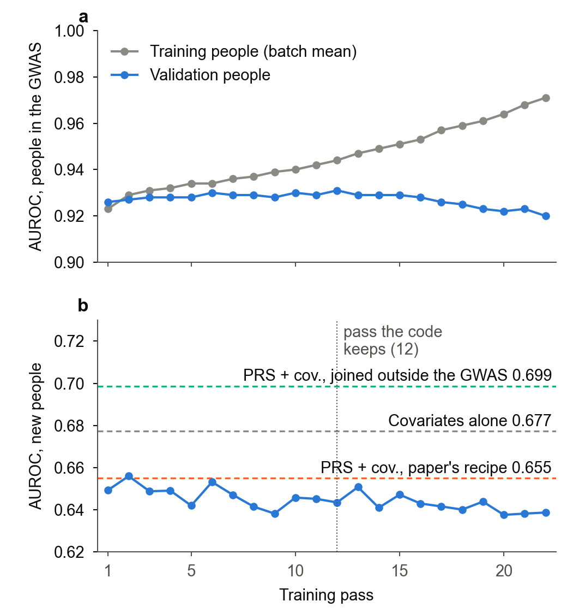
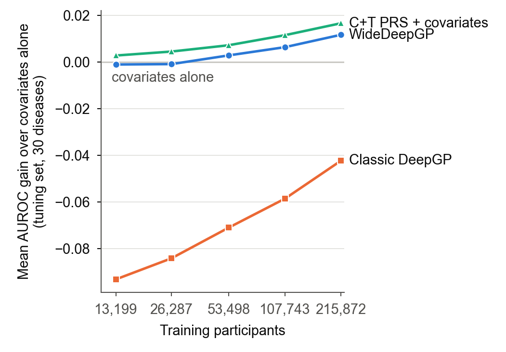

# DeepGP on type 2 diabetes: our replication, and DeepGP across five training sizes

*UK Biobank, application 15181. Compiled 26 November 2026. Aggregate results only. Every AUROC is measured on people
outside every GWAS, with a 95% bootstrap interval where we have one. Tables and figure data: `figures/`; sources:
`methods.md`.*

We reran the published DeepGP code to reproduce the paper's type 2 diabetes (T2D) result. This summary covers three
things:

- the design choices that reproduce the paper's DeepGP number;
- a weakness of the linear PRS baseline when the GWAS is small;
- how classic DeepGP and our WideDeepGP compare across five training sizes.

## In short

- **The paper's DeepGP is reproduced only with 1:1 random controls and risk-allele dosages.** That setup gives
  0.648–0.652 against the paper's 0.64.
    - With minor-allele dosages, which is what the paper states, the network learns nothing when controls are matched
    (0.500).
    - With random controls and minor-allele dosages it reaches 0.625, below covariates alone (0.677).
- **No single design reproduces the paper's PRS baseline (0.60) at the same time.** Built the paper's way, our PRS +
  covariates scores 0.655–0.659 with random controls and 0.618 with matched controls.
- **A PRS overfits the people its GWAS came from when the GWAS is small.** With 34,690 GWAS people it scores 0.95–1.00
  on those people and 0.56–0.62 on new people.
    - The paper's PRS + covariates regression, fitted on those same people, gives the PRS 6–12 times its proper weight.
    - That pulls the combined score down to, or below, covariates alone.
- **Classic DeepGP does not escape this in our runs.** It scores 0.99 on the GWAS people and 0.65 on new people.
    - On our five training sizes (30 diseases, the same design) it falls well below covariates alone: by 0.093 on
    average at 13,199 training people and by 0.042 at 215,872.
    - WideDeepGP stays close to the C+T PRS + covariates, slightly below it.
- **Two gaps.**
    - We never ran DeepGP without covariates on E11.
    - A rerun with the paper's multi-source diabetes definition stopped at its first GWAS step and has no result.

## 1. Did we set DeepGP up the way the paper did?

### Table 1. The paper's type 2 diabetes results

| Design | Training people (cases) | Test people (cases) | DeepGP | PRS + covariates | Other baselines |
|---|---|---|---|---|---|
| 1:1 cases and controls (main Table 1) | 44,828 (22,414) | 7,912 (3,956) | **0.64** | **0.60** | LightGBM 0.61; CNN 0.64; dense network 0.64; SNP-level logistic regression 0.60; MLP 0.59; random forest 0.51 |
| Population prevalence (Supp. Tables 2 and 5) | 309,830 (22,414) | 54,676 (3,956) | 0.673 (0.665–0.682) | 0.640 (0.631–0.650) | PRS-CSx + covariates 0.642 (0.634–0.651) |

The paper's setup:

- **SNPs.** About 100,000 lead SNPs from 13.3 million imputed SNPs (GWAS p ≤ 0.05, clumped at r² 0.7 within 500 kb).
- **Covariates.** Age, sex and the first six principal components.
- **Dosages.** The text says each counts the minor allele.
- **Controls.** "1:1"; what they were matched on is not stated.
- **Covariates alone.** No AUROC is reported for T2D.

### Table 2. Our DeepGP runs with minor-allele dosages (all with the covariates in the model)

| Cohort | Training people (cases) | Test people (cases) | 1:1? | DeepGP | Covariates alone |
|---|---|---|---|---|---|
| Controls matched on age and sex | 34,690 (17,345) | 3,326 (1,663) | yes | 0.500 (0.480–0.518) | 0.519 |
| same, early stopping off (30 passes) | | | | 0.522 (0.500–0.544) | |
| same, with the Mamba gradient bug fixed | | | | 0.524 (0.503–0.542) | |
| Random controls | 34,690 (17,345) | 3,326 (1,663) | yes | 0.625 (0.605–0.644) | 0.677 |
| Population prevalence (our pipeline) | 215,872 (17,345) | 20,000 (1,663) | no; half-case batches | 0.667 | 0.670 |
| Without covariates | not run for E11 | | | | |

How to read this table:

- **SNPs.** The 1:1 runs use 47,341 lead SNPs from our GWAS of all 215,872 training people (HapMap3+ SNPs, the
  paper's clumping).
- **The population-prevalence row** comes from our own pipeline:
    - its SNPs count the reference-panel alternative allele, which, like the minor allele, is unrelated to risk
    direction;
    - it uses 12 covariates;
    - it is scored on our 20,000-person tuning set;
    - with risk-allele dosages the same design gives 0.665, against the paper's population-prevalence DeepGP of 0.673.
- **Without covariates.** Our only classic DeepGP run without covariates is for hypertension (I10) at population
  prevalence: 0.518, against 0.699 with covariates and 0.699 for covariates alone.
- **Atrial fibrillation** (I48, minor allele, 1:1): DeepGP 0.493 with matched controls and 0.692 with random ones.
  Covariates alone score 0.510 and 0.743; the paper reports 0.74.

### Table 3. Controls matched on age and sex: minor- and risk-allele dosages

| Dosages count the | DeepGP | PRS + covariates, paper's recipe | PRS + covariates, joined outside the GWAS | PRS alone | Covariates alone |
|---|---|---|---|---|---|
| minor allele | 0.500 (0.480–0.518) | 0.618 (0.600–0.638) | 0.613 (0.594–0.634) | 0.618 (0.599–0.637) | 0.519 (0.498–0.539) |
| risk allele | 0.615 (0.596–0.634) | same | same | same | same |

- **Matching removes the age and sex signal** (covariates alone 0.519), so everything above 0.5 here is genetic.
- **Risk alleles are what let the network learn.** It reaches 0.615, close to the PRS (0.618).
- **A matched design does not reach the paper's 0.64 on our data**, even with risk alleles.

### Table 4. Our most faithful replication

The design: 1:1 random controls; a GWAS of the cohort's own training people on all imputed SNPs; risk-allele dosages;
the published code and settings.

| Model | Test AUROC (95% interval) | Paper |
|---|---|---|
| **DeepGP, risk-allele dosages** | **0.648 (0.629–0.666)** | 0.64 |
| PRS + covariates, paper's recipe (logistic regression fitted on the GWAS people) | 0.659 (0.642–0.679) | 0.60 |
| PRS alone (no covariates) | 0.578 (0.560–0.599) | not reported |
| PRS + covariates, joined on people outside the GWAS (5-fold) | 0.690 (0.673–0.708) | not reported |
| Covariates alone | 0.677 (0.659–0.695) | not reported |

DeepGP minus the recipe: −0.012 (−0.020 to −0.003). Training 34,690 people (17,345 cases); test 3,326 people (1,663
cases).

**What matched the paper**

- **Code.** The published repository (github.com/tndrg/DeepGP, commit 48e841d). We added three patches so it runs
  with a newer Mamba library; none changes any computation.
- **Settings.** The published T2D configuration (Supp. Table 7): batch 64, width 32, one Mamba block, four attention
  heads, two dense layers, dropout 0.2, learning rate 7 × 10⁻⁴, weight decay 10⁻⁴.
- **Covariates.** Age, sex and the first six principal components.
- **GWAS.** The paper's own PLINK script, unchanged, run on the training people only. As the paper's limitations note
  for its own GWAS, these include the people the code later holds out for validation. Clumping at p ≤ 0.05, r² 0.7,
  500 kb gives 98,440 lead SNPs (paper: about 100,000).
- **Balance.** 1:1 cases and controls, in training and in test.
- **Batches.** The code shuffles the 1:1 cohort, so each batch of 64 is half cases on average, not exactly 32 + 32.

**Our reading where the paper is silent or differs**

- **Controls** were drawn at random. The paper does not say what it matched on, and matched controls do not reproduce
  it (Table 3).
- **Dosages** count the risk allele: the allele whose odds ratio in the GWAS is above 1. The paper says minor allele,
  but with minor alleles the network does not learn (Tables 2 and 3).

**What differed from the paper**

- **Outcome: E11 from hospital and death records**, not the paper's definition (self-report, medication,
  HbA1c ≥ 6.5%, ICD-9 250, ICD-10 E10–E14, type 1 excluded).
    - Our cohort has 17,345 training cases (77% of the paper's 22,414) and 1,663 test cases (42% of its 3,956).
    - The test people come from our 20,000-person tuning set, because our main test set stays locked until the end of
    the study.
    - On the same people, the paper's definition would give 19,467 training cases (17,200 of them E11) and 1,867 test
    cases. Two of its fields, 2443 and 4041, are not in our data.
    - A rerun with that definition started on 21 November but stopped at its first GWAS step, with no result.
- **SNPs.** Drawn from 7.8 million imputed SNPs, not 13.3 million.
- **One network**, with seed 33 (fixed in the code). We ran no five-fold search of settings.
- **Early stopping: the code's own rule.**
    - It checks every 300 batches on a random 15% of the training people (inside the GWAS) and scores AUROC as the
    average over batches of 64.
    - It stops after 10 checks without improvement, or at 30 passes, and keeps the best check.
    - The paper says only "early stopping". Our run stopped at pass 25 and kept pass 15.
- **Were we undertraining? No.**
    - On new people, AUROC was already 0.649 after the first 300 batches and 0.646 after one pass, against 0.648 for
    the model kept.
    - In a rerun scored on new people after every pass, it never rose after pass 2 (Figure 1).
    - The problem is the reverse: the validation people sit inside the GWAS and score 0.93–0.99 from the first check,
    so the rule cannot tell a good pass from a bad one.
    - With minor-allele dosages the network was still on its starting plateau when it stopped at pass 22. Run to pass
    30 it reached only 0.522.

<figure markdown="1">

<figcaption><strong>Figure 1. More training does not help on new people.</strong> Risk-allele DeepGP on the 1:1
random-controls cohort (GWAS of 215,872 people), rerun with the new people scored after every pass. <strong>a</strong>, AUROC on
training and validation people, both inside the GWAS. <strong>b</strong>, AUROC on new people, with the pass the code keeps and
three reference lines. Scoring the new people changed nothing in training and chose nothing. From the replication
write-up (<code>../deepgp-replication/</code>).</figcaption>
</figure>

## 2. Where the linear PRS breaks: small GWAS

### Table 5. Cohort's own GWAS (34,690 people): AUROC on the GWAS people and on new people

| Model | GWAS people, training part (29,486) | GWAS people, validation part (5,204) | New people (3,326) | Drop | PRS over-weighting in the recipe | Covariates' share of the score: recipe → fitted on new people |
|---|---|---|---|---|---|---|
| C+T PRS alone | 0.984 (all 34,690) | | 0.578 | −0.41 | | |
| C+T PRS + covariates, paper's recipe | 0.995 | 0.995 | 0.659 | −0.34 | **11.8×** | 28% → 83% |
| LDpred2-auto alone | 0.950 | 0.950 | 0.621 | −0.33 | | |
| LDpred2-auto + covariates, recipe | 0.970 | 0.971 | **0.686** | −0.28 | **5.8×** | 21% → 67% |
| lassosum2 alone (penalty chosen on the validation part) | 0.999 | 0.999 | 0.563 | −0.44 | | |
| lassosum2 + covariates, recipe | 1.000 | 1.000 | 0.657 | −0.34 | not computed | |
| **DeepGP, risk allele, after 300 batches** | 0.992 | 0.989 | 0.649 | −0.34 | | |
| **DeepGP, risk allele, model kept (pass 15)** | 0.995 (mean over batches) | 0.992 | 0.648 | −0.35 | | |
| Covariates alone | 0.652 | 0.659 | 0.678 | +0.03 | | |

How to read the columns:

- **Drop** = AUROC on new people minus AUROC on the training part.
- **PRS over-weighting** = the PRS's weight in the recipe divided by the weight a regression fitted on the new people
  gives it.
- **Covariates' share** = the share of the combined score's spread that comes from the covariates.
- **LDpred2-auto and lassosum2** use a GWAS of the same people on HapMap3+ SNPs, fitted with our PGI arm's code.

### Table 6. A larger GWAS overfits less (same 1:1 random-controls cohort, same new people)

| GWAS people | Lead SNPs | C+T PRS alone: GWAS people → new people | Recipe: GWAS people → new people | PRS over-weighting | Risk-allele DeepGP: GWAS people → new people |
|---|---|---|---|---|---|
| 34,690 (the cohort's own GWAS, all imputed SNPs) | 98,440 | 0.984 → 0.578 | 0.995 → 0.659 | 11.8× | 0.995 → 0.648 |
| 215,872 (all our training people, HapMap3+) | 47,341 | 0.917 → 0.602 | 0.931 → 0.655 | 5.5× | 0.92–0.96 → 0.652 |

- **DeepGP's in-GWAS AUROC** is the mean over training batches at the pass the code kept (34,690) or across passes
  (215,872).
- **Same over-weighting with fewer SNPs.** Random 5–75% subsets of the 98,440 lead SNPs give 11.3–12.4×, so the size
  of the GWAS sets it, not the number of SNPs.
- **Population prevalence** (GWAS of 215,872, scored on our 20,000 tuning people). On the training people versus the
  new people:
    - C+T scores 0.917 versus 0.615;
    - LDpred2-auto scores 0.917 versus 0.651;
    - lassosum2 scores 0.903 versus 0.630.
    - The C+T recipe gives 0.666, against 0.669 for covariates alone.

### Table 7. The same pattern at every training size (LDpred2-auto alone, three other diseases)

| Training people | I10 hypertension | K57 diverticular disease | I48 atrial fibrillation |
|---|---|---|---|
| 13,199 | 0.997 → 0.533 | 1.000 → 0.524 | 1.000 → 0.529 |
| 26,287 | 0.980 → 0.548 | 0.994 → 0.533 | 0.996 → 0.556 |
| 53,498 | 0.935 → 0.572 | 0.963 → 0.554 | 0.950 → 0.579 |
| 107,743 | 0.871 → 0.596 | 0.906 → 0.581 | 0.881 → 0.605 |
| 215,872 | 0.812 → 0.615 | 0.862 → 0.602 | 0.812 → 0.621 |

AUROC on the rung's training people (all in its GWAS) → on our 20,000 tuning people (outside it). E11 was not scored
on training people below the top rung; at the top rung it gives 0.917 → 0.651.

**What this shows**

- **Below about 50,000 GWAS people, every linear PRS overfits the people it was fitted on.**
    - It scores 0.95–1.00 on them and 0.53–0.62 on new people.
    - Fitting the PRS + covariates regression on those people, as the paper's recipe does, gives the PRS 6–12 times its
    proper weight. The covariates' share of the score falls from 67–83% to 21–28%.
    - The combined score ends at or below covariates alone: C+T 0.659 and lassosum2 0.657, against 0.678. Only
    LDpred2-auto clears it (0.686).
- **A bigger GWAS halves the over-weighting** (11.8× at 34,690 people, 5.5× at 215,872). Across our ladder, LDpred2's
  AUROC on its own training people falls from 1.00 to 0.81–0.86, while on new people it rises from 0.53 to 0.60–0.62.
- **Do modern methods overfit harder than C+T? For lassosum2, yes; for LDpred2-auto, no.**
    - lassosum2, tuned on validation people inside the GWAS: 0.999 → 0.563, against C+T's 0.984 → 0.578.
    - LDpred2-auto overfits less (0.950 → 0.621). It is the only genetic model whose recipe score beats covariates alone.
- **Classic DeepGP does not avoid this in our runs.**
    - It loses as much between the GWAS people and new people as the recipe does (0.995 → 0.648, against 0.995 → 0.659),
    because its SNPs and their risk direction come from the same GWAS.
    - On our five training sizes it falls further below covariates alone than any PRS does (section 3).
- **The opening for DeepGP, not yet shown.**
    - The weakness to exploit is that a PRS fitted on its own GWAS people over-weights genetics against covariates.
    - A model trained on people outside the GWAS could avoid it: for example, DeepGP given SNPs from a GWAS of one half of
    the training set and trained on the other half.
    - The linear version of that fix, joining the PRS to the covariates on people outside the GWAS, already reaches
    0.690. That is the bar to beat.

## 3. Five training sizes, 30 diseases (our main study, separate from the replication)

The comparison setup:

- **Data.** Real UK Biobank labels for 30 diseases. Training sizes 13,199 to 215,872 people. The same 20,000 tuning
  people for every model and size.
- **How each AUROC is read.** At each model's best check on the tuning set, so every number is mildly optimistic.
- **Classic DeepGP** is the published network with what the replication taught:
    - risk-allele dosages;
    - the paper's SNP rule applied to each size's own GWAS;
    - the T2D settings for every disease, half-case batches and one seed.
- **WideDeepGP** is the mean of three seeds.
- **C+T** is our PGI arm's clumping-and-thresholding PRS. It is joined to the covariates by a logistic regression
  fitted on the tuning people, our shared comparison rule. Its own covariates-only fit gives 0.6653, so compare gains
  over covariates rather than raw AUROCs.

### Table 8. Mean tuning AUROC over the 30 diseases (gain over covariates alone in brackets)

| Training people | Covariates alone | Classic DeepGP | WideDeepGP (3 seeds, mean ± SD) | Ridge PRS + covariates (WideDeepGP's linear twin) | C+T PRS + covariates (own covariates 0.6653) | Classic above covariates | WideDeepGP above covariates |
|---|---|---|---|---|---|---|---|
| 13,199 | 0.6598 | 0.5667 (−0.093) | 0.6587 ± 0.0002 (−0.001) | 0.6611 (+0.001) | 0.6680 (+0.003) | 0 of 30 | 6 of 30 |
| 26,287 | 0.6613 | 0.5772 (−0.084) | 0.6604 ± 0.0004 (−0.001) | 0.6638 (+0.002) | 0.6697 (+0.004) | 0 of 30 | 7 of 30 |
| 53,498 | 0.6620 | 0.5910 (−0.071) | 0.6648 ± 0.0006 (+0.003) | 0.6670 (+0.005) | 0.6724 (+0.007) | 1 of 30 | 22 of 30 |
| 107,743 | 0.6625 | 0.6039 (−0.059) | 0.6688 ± 0.0003 (+0.006) | 0.6718 (+0.009) | 0.6768 (+0.011) | 1 of 30 | 26 of 30 |
| 215,872 | 0.6627 | 0.6204 (−0.042) | 0.6743 ± 0.0006 (+0.012) | 0.6777 (+0.015) | 0.6819 (+0.017) | 2 of 30 | 28 of 30 |

- **Classic DeepGP is below covariates alone for 28–30 of the 30 diseases at every size.**
    - The deficit is largest where age and sex predict well: hypotension, osteoporosis, kidney failure, heart attack,
    heart failure.
    - It shrinks as the GWAS grows.
    - This is the pattern the over-weighted PRS recipe shows (section 2). Our reading: trained on the people its GWAS
    came from, the network leans on SNPs that look strong in that sample and under-uses the covariates.
- **WideDeepGP beats classic DeepGP for all 30 diseases at every size.**
    - It beats covariates alone from 53,498 people up.
    - It stays below the C+T and ridge PRS + covariates. At the top size it reaches 70% of C+T's gain over covariates
    (0.0116 against 0.0165).

<figure markdown="1">

<figcaption><strong>Figure 2. Mean gain over covariates alone, by training size.</strong> Tuning AUROC minus
covariates alone, averaged over 30 diseases. C+T is measured against its own covariates-only fit on the tuning set.
Data: <code>figures/ladder_means.csv</code>.</figcaption>
</figure>

<figure markdown="1">

<figcaption><strong>Figure 3. The same, disease by disease.</strong> One panel per disease, ordered by number of
cases. The y axis is shared across panels. Data: <code>figures/ladder_per_disease.csv</code>.</figcaption>
</figure>

### Table 9. Per disease, tuning AUROC

Columns:

- **Covariates alone**: the logistic regression fitted on the training people, the floor for both DeepGP models.
- **C+T + covariates** and its **own covariates**: both fitted on the tuning people.
- **Cases**: tuning-set cases. WideDeepGP is the mean of seeds 1–3.

215,872 training people

| Disease | Cases | Covariates alone | Classic DeepGP | WideDeepGP | C+T + covariates | C+T's own covariates |
|---|---|---|---|---|---|---|
| I10 Hypertension | 6,255 | 0.699 | 0.694 | 0.716 | 0.721 | 0.699 |
| E78 Lipid disorders | 3,153 | 0.691 | 0.662 | 0.705 | 0.705 | 0.692 |
| K57 Diverticular disease | 2,784 | 0.626 | 0.616 | 0.632 | 0.653 | 0.627 |
| K21 Reflux disease | 2,387 | 0.589 | 0.570 | 0.606 | 0.610 | 0.592 |
| K29 Gastritis | 2,238 | 0.603 | 0.561 | 0.612 | 0.614 | 0.604 |
| K44 Diaphragmatic hernia | 2,271 | 0.615 | 0.590 | 0.624 | 0.636 | 0.619 |
| I25 Ischaemic heart disease | 2,126 | 0.731 | 0.681 | 0.741 | 0.742 | 0.733 |
| M19 Other arthrosis | 1,966 | 0.660 | 0.607 | 0.670 | 0.669 | 0.662 |
| I84+K64 Haemorrhoids | 1,962 | 0.537 | 0.540 | 0.552 | 0.565 | 0.549 |
| I48 Atrial fibrillation | 1,670 | 0.747 | 0.701 | 0.750 | 0.766 | 0.748 |
| M17 Knee arthrosis | 1,675 | 0.629 | 0.600 | 0.642 | 0.648 | 0.631 |
| C44 Other skin cancer | 1,676 | 0.667 | 0.641 | 0.668 | 0.695 | 0.668 |
| E11 Type 2 diabetes | 1,663 | 0.670 | 0.664 | 0.696 | 0.705 | 0.671 |
| E66 Obesity | 1,478 | 0.550 | 0.598 | 0.608 | 0.612 | 0.556 |
| M54 Back pain | 1,310 | 0.588 | 0.559 | 0.613 | 0.602 | 0.590 |
| D12 Benign bowel tumour | 1,309 | 0.620 | 0.586 | 0.629 | 0.644 | 0.622 |
| I20 Angina | 1,284 | 0.704 | 0.640 | 0.718 | 0.718 | 0.706 |
| E03 Hypothyroidism | 1,211 | 0.679 | 0.667 | 0.687 | 0.716 | 0.682 |
| K40 Inguinal hernia | 1,140 | 0.779 | 0.732 | 0.780 | 0.793 | 0.781 |
| M16 Hip arthrosis | 1,106 | 0.660 | 0.615 | 0.659 | 0.675 | 0.661 |
| K80 Gallstones | 1,118 | 0.609 | 0.602 | 0.621 | 0.642 | 0.612 |
| N17 Acute kidney failure | 1,007 | 0.699 | 0.605 | 0.705 | 0.703 | 0.700 |
| N18 Chronic kidney disease | 943 | 0.724 | 0.637 | 0.732 | 0.733 | 0.726 |
| J44 COPD | 986 | 0.688 | 0.620 | 0.703 | 0.704 | 0.691 |
| M23 Knee derangement | 872 | 0.571 | 0.543 | 0.589 | 0.593 | 0.580 |
| M47 Spondylosis | 797 | 0.642 | 0.568 | 0.648 | 0.651 | 0.646 |
| I95 Hypotension | 834 | 0.691 | 0.574 | 0.694 | 0.694 | 0.692 |
| I50 Heart failure | 814 | 0.721 | 0.641 | 0.727 | 0.731 | 0.723 |
| M81 Osteoporosis | 840 | 0.761 | 0.663 | 0.761 | 0.769 | 0.763 |
| I21 Heart attack | 730 | 0.732 | 0.638 | 0.741 | 0.745 | 0.735 |
| **Mean** |  | **0.663** | **0.620** | **0.674** | **0.682** | **0.665** |

107,743 training people

| Disease | Cases | Covariates alone | Classic DeepGP | WideDeepGP | C+T + covariates | C+T's own covariates |
|---|---|---|---|---|---|---|
| I10 Hypertension | 6,255 | 0.699 | 0.677 | 0.706 | 0.714 | 0.699 |
| E78 Lipid disorders | 3,153 | 0.691 | 0.635 | 0.700 | 0.702 | 0.692 |
| K57 Diverticular disease | 2,784 | 0.626 | 0.599 | 0.628 | 0.644 | 0.627 |
| K21 Reflux disease | 2,387 | 0.590 | 0.563 | 0.601 | 0.606 | 0.592 |
| K29 Gastritis | 2,238 | 0.602 | 0.559 | 0.610 | 0.609 | 0.604 |
| K44 Diaphragmatic hernia | 2,271 | 0.615 | 0.567 | 0.622 | 0.629 | 0.619 |
| I25 Ischaemic heart disease | 2,126 | 0.731 | 0.655 | 0.737 | 0.738 | 0.733 |
| M19 Other arthrosis | 1,966 | 0.660 | 0.587 | 0.663 | 0.666 | 0.662 |
| I84+K64 Haemorrhoids | 1,962 | 0.536 | 0.526 | 0.539 | 0.559 | 0.549 |
| I48 Atrial fibrillation | 1,670 | 0.747 | 0.670 | 0.749 | 0.761 | 0.748 |
| M17 Knee arthrosis | 1,675 | 0.629 | 0.581 | 0.633 | 0.642 | 0.631 |
| C44 Other skin cancer | 1,676 | 0.667 | 0.625 | 0.667 | 0.687 | 0.668 |
| E11 Type 2 diabetes | 1,663 | 0.670 | 0.626 | 0.683 | 0.695 | 0.671 |
| E66 Obesity | 1,478 | 0.546 | 0.572 | 0.589 | 0.598 | 0.556 |
| M54 Back pain | 1,310 | 0.588 | 0.554 | 0.599 | 0.597 | 0.590 |
| D12 Benign bowel tumour | 1,309 | 0.620 | 0.574 | 0.628 | 0.636 | 0.622 |
| I20 Angina | 1,284 | 0.705 | 0.617 | 0.712 | 0.712 | 0.706 |
| E03 Hypothyroidism | 1,211 | 0.678 | 0.636 | 0.683 | 0.706 | 0.682 |
| K40 Inguinal hernia | 1,140 | 0.779 | 0.692 | 0.779 | 0.793 | 0.781 |
| M16 Hip arthrosis | 1,106 | 0.659 | 0.593 | 0.658 | 0.667 | 0.661 |
| K80 Gallstones | 1,118 | 0.609 | 0.576 | 0.614 | 0.642 | 0.612 |
| N17 Acute kidney failure | 1,007 | 0.699 | 0.588 | 0.702 | 0.701 | 0.700 |
| N18 Chronic kidney disease | 943 | 0.723 | 0.625 | 0.727 | 0.731 | 0.726 |
| J44 COPD | 986 | 0.689 | 0.619 | 0.695 | 0.697 | 0.691 |
| M23 Knee derangement | 872 | 0.571 | 0.544 | 0.586 | 0.590 | 0.580 |
| M47 Spondylosis | 797 | 0.643 | 0.561 | 0.642 | 0.650 | 0.646 |
| I95 Hypotension | 834 | 0.691 | 0.561 | 0.692 | 0.693 | 0.692 |
| I50 Heart failure | 814 | 0.722 | 0.647 | 0.725 | 0.730 | 0.723 |
| M81 Osteoporosis | 840 | 0.760 | 0.651 | 0.759 | 0.766 | 0.763 |
| I21 Heart attack | 730 | 0.731 | 0.638 | 0.737 | 0.743 | 0.735 |
| **Mean** |  | **0.662** | **0.604** | **0.669** | **0.677** | **0.665** |

53,498 training people

| Disease | Cases | Covariates alone | Classic DeepGP | WideDeepGP | C+T + covariates | C+T's own covariates |
|---|---|---|---|---|---|---|
| I10 Hypertension | 6,255 | 0.699 | 0.658 | 0.702 | 0.709 | 0.699 |
| E78 Lipid disorders | 3,153 | 0.691 | 0.631 | 0.695 | 0.699 | 0.692 |
| K57 Diverticular disease | 2,784 | 0.626 | 0.576 | 0.625 | 0.634 | 0.627 |
| K21 Reflux disease | 2,387 | 0.590 | 0.548 | 0.597 | 0.599 | 0.592 |
| K29 Gastritis | 2,238 | 0.602 | 0.546 | 0.606 | 0.608 | 0.604 |
| K44 Diaphragmatic hernia | 2,271 | 0.615 | 0.558 | 0.619 | 0.626 | 0.619 |
| I25 Ischaemic heart disease | 2,126 | 0.731 | 0.630 | 0.733 | 0.735 | 0.733 |
| M19 Other arthrosis | 1,966 | 0.659 | 0.578 | 0.659 | 0.665 | 0.662 |
| I84+K64 Haemorrhoids | 1,962 | 0.536 | 0.517 | 0.538 | 0.552 | 0.549 |
| I48 Atrial fibrillation | 1,670 | 0.747 | 0.651 | 0.747 | 0.757 | 0.748 |
| M17 Knee arthrosis | 1,675 | 0.628 | 0.569 | 0.632 | 0.636 | 0.631 |
| C44 Other skin cancer | 1,676 | 0.667 | 0.599 | 0.664 | 0.682 | 0.668 |
| E11 Type 2 diabetes | 1,663 | 0.669 | 0.614 | 0.674 | 0.686 | 0.671 |
| E66 Obesity | 1,478 | 0.545 | 0.554 | 0.568 | 0.577 | 0.556 |
| M54 Back pain | 1,310 | 0.587 | 0.548 | 0.590 | 0.596 | 0.590 |
| D12 Benign bowel tumour | 1,309 | 0.619 | 0.560 | 0.625 | 0.627 | 0.622 |
| I20 Angina | 1,284 | 0.704 | 0.614 | 0.707 | 0.710 | 0.706 |
| E03 Hypothyroidism | 1,211 | 0.678 | 0.614 | 0.681 | 0.704 | 0.682 |
| K40 Inguinal hernia | 1,140 | 0.778 | 0.682 | 0.776 | 0.787 | 0.781 |
| M16 Hip arthrosis | 1,106 | 0.658 | 0.555 | 0.655 | 0.662 | 0.661 |
| K80 Gallstones | 1,118 | 0.606 | 0.573 | 0.611 | 0.632 | 0.612 |
| N17 Acute kidney failure | 1,007 | 0.698 | 0.593 | 0.700 | 0.701 | 0.700 |
| N18 Chronic kidney disease | 943 | 0.722 | 0.627 | 0.727 | 0.730 | 0.726 |
| J44 COPD | 986 | 0.688 | 0.582 | 0.689 | 0.694 | 0.691 |
| M23 Knee derangement | 872 | 0.571 | 0.530 | 0.583 | 0.589 | 0.580 |
| M47 Spondylosis | 797 | 0.642 | 0.563 | 0.640 | 0.648 | 0.646 |
| I95 Hypotension | 834 | 0.691 | 0.562 | 0.689 | 0.694 | 0.692 |
| I50 Heart failure | 814 | 0.721 | 0.626 | 0.721 | 0.728 | 0.723 |
| M81 Osteoporosis | 840 | 0.760 | 0.643 | 0.756 | 0.764 | 0.763 |
| I21 Heart attack | 730 | 0.731 | 0.628 | 0.733 | 0.740 | 0.735 |
| **Mean** |  | **0.662** | **0.591** | **0.665** | **0.672** | **0.665** |

26,287 training people

| Disease | Cases | Covariates alone | Classic DeepGP | WideDeepGP | C+T + covariates | C+T's own covariates |
|---|---|---|---|---|---|---|
| I10 Hypertension | 6,255 | 0.699 | 0.656 | 0.697 | 0.706 | 0.699 |
| E78 Lipid disorders | 3,153 | 0.691 | 0.631 | 0.690 | 0.695 | 0.692 |
| K57 Diverticular disease | 2,784 | 0.625 | 0.558 | 0.623 | 0.629 | 0.627 |
| K21 Reflux disease | 2,387 | 0.590 | 0.537 | 0.589 | 0.597 | 0.592 |
| K29 Gastritis | 2,238 | 0.601 | 0.542 | 0.599 | 0.607 | 0.604 |
| K44 Diaphragmatic hernia | 2,271 | 0.615 | 0.560 | 0.613 | 0.623 | 0.619 |
| I25 Ischaemic heart disease | 2,126 | 0.732 | 0.628 | 0.731 | 0.734 | 0.733 |
| M19 Other arthrosis | 1,966 | 0.658 | 0.576 | 0.658 | 0.664 | 0.662 |
| I84+K64 Haemorrhoids | 1,962 | 0.534 | 0.516 | 0.535 | 0.553 | 0.549 |
| I48 Atrial fibrillation | 1,670 | 0.747 | 0.648 | 0.745 | 0.755 | 0.748 |
| M17 Knee arthrosis | 1,675 | 0.627 | 0.556 | 0.629 | 0.633 | 0.631 |
| C44 Other skin cancer | 1,676 | 0.666 | 0.577 | 0.665 | 0.671 | 0.668 |
| E11 Type 2 diabetes | 1,663 | 0.669 | 0.599 | 0.668 | 0.679 | 0.671 |
| E66 Obesity | 1,478 | 0.543 | 0.536 | 0.543 | 0.568 | 0.556 |
| M54 Back pain | 1,310 | 0.586 | 0.537 | 0.585 | 0.598 | 0.590 |
| D12 Benign bowel tumour | 1,309 | 0.620 | 0.544 | 0.619 | 0.623 | 0.622 |
| I20 Angina | 1,284 | 0.704 | 0.568 | 0.703 | 0.708 | 0.706 |
| E03 Hypothyroidism | 1,211 | 0.678 | 0.590 | 0.680 | 0.697 | 0.682 |
| K40 Inguinal hernia | 1,140 | 0.778 | 0.680 | 0.775 | 0.784 | 0.781 |
| M16 Hip arthrosis | 1,106 | 0.657 | 0.556 | 0.657 | 0.663 | 0.661 |
| K80 Gallstones | 1,118 | 0.603 | 0.546 | 0.607 | 0.632 | 0.612 |
| N17 Acute kidney failure | 1,007 | 0.698 | 0.573 | 0.698 | 0.700 | 0.700 |
| N18 Chronic kidney disease | 943 | 0.722 | 0.609 | 0.722 | 0.728 | 0.726 |
| J44 COPD | 986 | 0.686 | 0.579 | 0.685 | 0.694 | 0.691 |
| M23 Knee derangement | 872 | 0.573 | 0.525 | 0.566 | 0.584 | 0.580 |
| M47 Spondylosis | 797 | 0.643 | 0.564 | 0.638 | 0.649 | 0.646 |
| I95 Hypotension | 834 | 0.690 | 0.559 | 0.687 | 0.693 | 0.692 |
| I50 Heart failure | 814 | 0.720 | 0.591 | 0.719 | 0.724 | 0.723 |
| M81 Osteoporosis | 840 | 0.760 | 0.590 | 0.756 | 0.764 | 0.763 |
| I21 Heart attack | 730 | 0.730 | 0.583 | 0.729 | 0.737 | 0.735 |
| **Mean** |  | **0.661** | **0.577** | **0.660** | **0.670** | **0.665** |

13,199 training people

| Disease | Cases | Covariates alone | Classic DeepGP | WideDeepGP | C+T + covariates | C+T's own covariates |
|---|---|---|---|---|---|---|
| I10 Hypertension | 6,255 | 0.699 | 0.653 | 0.697 | 0.702 | 0.699 |
| E78 Lipid disorders | 3,153 | 0.690 | 0.615 | 0.690 | 0.694 | 0.692 |
| K57 Diverticular disease | 2,784 | 0.624 | 0.569 | 0.623 | 0.628 | 0.627 |
| K21 Reflux disease | 2,387 | 0.586 | 0.531 | 0.588 | 0.596 | 0.592 |
| K29 Gastritis | 2,238 | 0.596 | 0.537 | 0.593 | 0.606 | 0.604 |
| K44 Diaphragmatic hernia | 2,271 | 0.613 | 0.527 | 0.611 | 0.619 | 0.619 |
| I25 Ischaemic heart disease | 2,126 | 0.731 | 0.636 | 0.730 | 0.733 | 0.733 |
| M19 Other arthrosis | 1,966 | 0.657 | 0.570 | 0.656 | 0.664 | 0.662 |
| I84+K64 Haemorrhoids | 1,962 | 0.529 | 0.514 | 0.532 | 0.551 | 0.549 |
| I48 Atrial fibrillation | 1,670 | 0.746 | 0.641 | 0.743 | 0.753 | 0.748 |
| M17 Knee arthrosis | 1,675 | 0.625 | 0.538 | 0.627 | 0.634 | 0.631 |
| C44 Other skin cancer | 1,676 | 0.665 | 0.583 | 0.664 | 0.670 | 0.668 |
| E11 Type 2 diabetes | 1,663 | 0.668 | 0.561 | 0.666 | 0.674 | 0.671 |
| E66 Obesity | 1,478 | 0.542 | 0.534 | 0.541 | 0.564 | 0.556 |
| M54 Back pain | 1,310 | 0.584 | 0.527 | 0.586 | 0.592 | 0.590 |
| D12 Benign bowel tumour | 1,309 | 0.619 | 0.531 | 0.615 | 0.623 | 0.622 |
| I20 Angina | 1,284 | 0.703 | 0.599 | 0.702 | 0.707 | 0.706 |
| E03 Hypothyroidism | 1,211 | 0.677 | 0.571 | 0.680 | 0.688 | 0.682 |
| K40 Inguinal hernia | 1,140 | 0.777 | 0.664 | 0.773 | 0.783 | 0.781 |
| M16 Hip arthrosis | 1,106 | 0.657 | 0.545 | 0.654 | 0.661 | 0.661 |
| K80 Gallstones | 1,118 | 0.603 | 0.528 | 0.604 | 0.625 | 0.612 |
| N17 Acute kidney failure | 1,007 | 0.697 | 0.548 | 0.697 | 0.701 | 0.700 |
| N18 Chronic kidney disease | 943 | 0.720 | 0.561 | 0.719 | 0.727 | 0.726 |
| J44 COPD | 986 | 0.685 | 0.561 | 0.684 | 0.693 | 0.691 |
| M23 Knee derangement | 872 | 0.566 | 0.519 | 0.565 | 0.584 | 0.580 |
| M47 Spondylosis | 797 | 0.641 | 0.528 | 0.638 | 0.651 | 0.646 |
| I95 Hypotension | 834 | 0.688 | 0.562 | 0.685 | 0.693 | 0.692 |
| I50 Heart failure | 814 | 0.721 | 0.555 | 0.718 | 0.724 | 0.723 |
| M81 Osteoporosis | 840 | 0.757 | 0.591 | 0.753 | 0.765 | 0.763 |
| I21 Heart attack | 730 | 0.728 | 0.601 | 0.728 | 0.736 | 0.735 |
| **Mean** |  | **0.660** | **0.567** | **0.659** | **0.668** | **0.665** |

### How WideDeepGP differs from classic DeepGP

- **Which SNPs.**
    - Classic: one model per disease, on the 30,000–58,000 lead SNPs that disease's GWAS picks (p ≤ 0.05, clumped at
    r² 0.7 within 500 kb). Each SNP counts its risk allele.
    - WideDeepGP: one model for all 30 diseases, on all 1,258,200 HapMap3+ SNPs, with no selection.
- **First layer: what a SNP contributes.**
    - Classic: every SNP on a chromosome passes through the same small filter, three neighbouring SNPs at a time. SNPs
    are told apart only by a fixed code for their base-pair position, so no SNP has a weight of its own.
    - WideDeepGP: every SNP has its own 32 numbers, taken from a ridge regression of all 30 diseases on the SNPs (the
    "30-disease ridge"):
    - the ridge is fitted within each LD block, on the disease labels with the covariates' linear effect removed;
    - 30 diseases × 3 penalties give 90 weights per SNP, compressed to 32;
    - it is cross-fitted: five copies, each fitted without one fifth of the training people, and each person is scored
      by a copy that never saw them;
    - the layer is fixed, not trained.
- **Grouping.**
    - Classic: SNPs are grouped by chromosome, and each chromosome's SNPs are averaged into one vector.
    - WideDeepGP: each person's dosages times their SNPs' numbers are summed within each of the 431 LD blocks of Privé et
    al. That gives one vector of 32 numbers per block, plus a learned label for each block and chromosome.
- **Mixer.**
    - Classic: a Mamba (state-space) layer runs along each chromosome's SNPs, then attention runs across the 22
    chromosome vectors and a covariate vector.
    - WideDeepGP: a small transformer (two layers, width 32, four heads) lets the 431 block vectors and a covariate token
    attend to one another.
- **Output.**
    - Classic: one output, for one disease.
    - WideDeepGP: the average of the tokens, beside the covariates, goes into a shared layer of 256. A small head per
    disease then gives 30 outputs.
- **Training.**
    - Classic: the paper's T2D settings for every disease, with half-case batches.
    - WideDeepGP: shuffled batches at population prevalence, with each disease's loss scaled by its prevalence. One
    setting, chosen at the top size, is used for all sizes.
    - Trained parameters: about 0.46 million per disease for classic DeepGP, and 0.32 million for WideDeepGP (plus a
    fixed table of 201 million numbers).

## Questions for the authors

- Which allele did the dosages count?
- How were the 1:1 controls chosen: at random, or matched on something?
- Was the balanced analysis's GWAS run on the balanced training set?
- How was the PRS + covariates baseline fitted? Fitted on the GWAS people, ours gives 0.659 with random controls, not
  0.60.
- Was the reported model one network, one fold's network, or an average of five?
- What is the covariates-only AUROC for T2D? Supplementary Figure 6 does not label the diseases.
