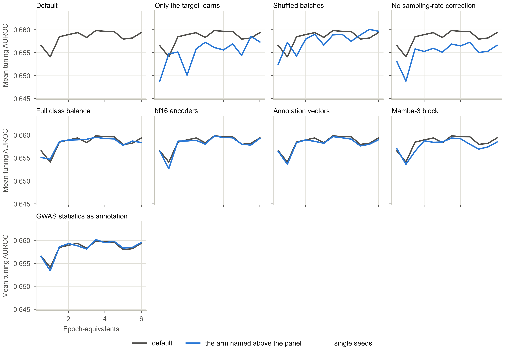
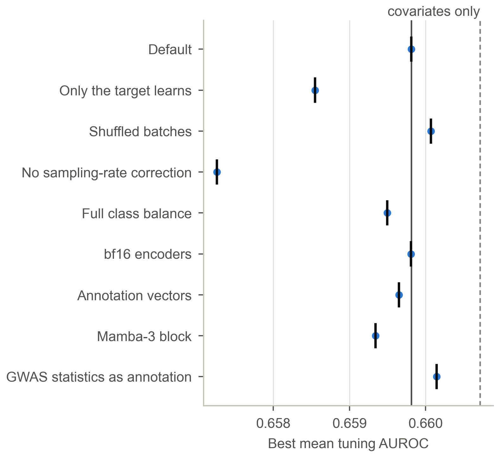
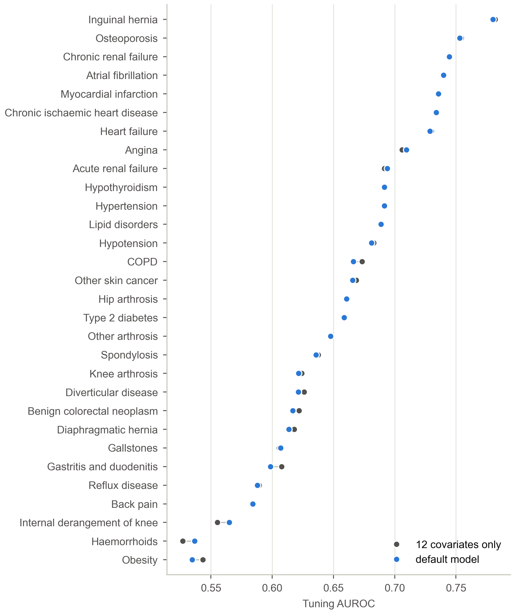
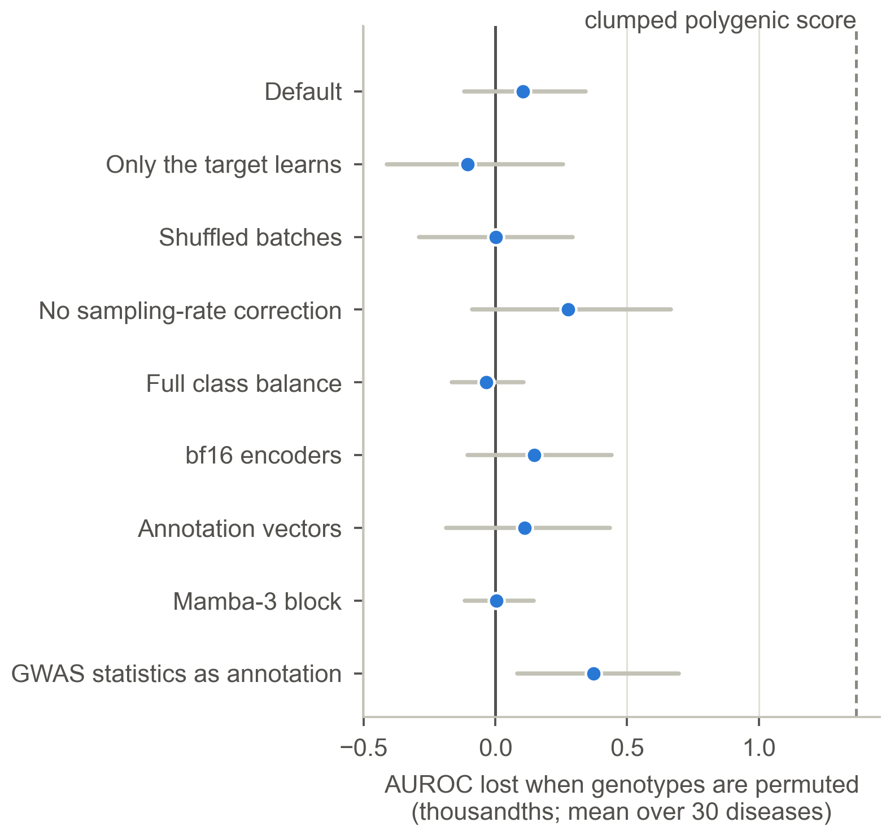
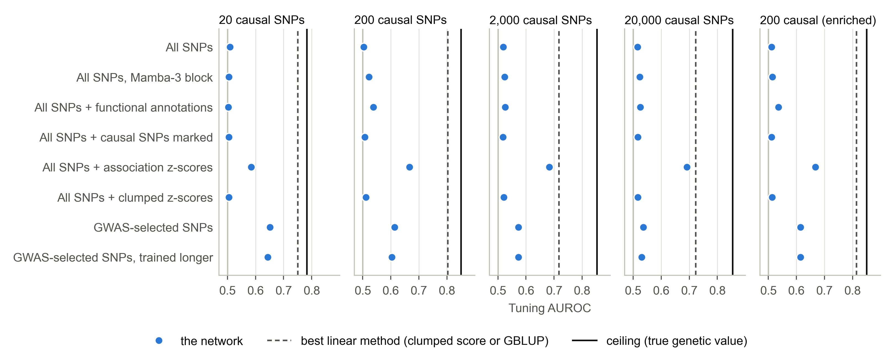

# Results: pilot of the multi-disease DeepGP (WideDeepGP)

*Analysis `widedeepgp-pilot`, 11–12 November 2026. Methods: `methods.md`. Tables and figures:
`results/`.*

## Summary

1. **The training pipeline works at full size as planned.** A batch of 18 participants with all
   1,258,200 SNPs trains in 38 GiB at 1.6 s per step. The measured batch limits (21 in 32-bit,
   36 with bf16 encoders, 69 with checkpointing, 130 with both) are the ones the plan
   predicted, and an epoch-equivalent costs 4.7 GPU-hours in 32-bit and 3.6 with bf16.
2. **On the proxy dataset no arm learned anything from the genotypes.** Every arm ends at the
   AUROC of a logistic model on year of birth, sex and principal components (0.657 to 0.660
   against 0.661), and giving each participant someone else's genotypes changes the AUROC by at
   most 0.0004. The pilot therefore cannot say which design learns genetics better.
3. **A positive control shows that this is not only because the proxy is small.** On traits
   simulated on the same real genotypes, where a clumped polygenic score or GBLUP fitted to
   the same participants reaches 0.72 to 0.81 (ceiling 0.78 to 0.85), the network stays at
   0.51. Mamba-3, the functional annotations and a mark on the causal SNPs do not change that.
4. **The network learns when SNP-specific, signed information is supplied.** Slowly on
   GWAS-selected SNPs (reaching 0.55 to 0.68), and on all SNPs when every SNP carries its
   association *z*-score as annotation (0.59 to 0.69, within 0.04 of GBLUP on the polygenic
   traits). The encoders share weights across SNPs and average over a chromosome, and the
   32-feature position code is too coarse to tell tens of thousands of SNPs apart; without
   help the network has no way to give a SNP its own effect.
5. **On the real labels the proxy holds little to find.** A clumped score built from 165,872
   other participants adds 0.0014 to the mean AUROC there. With the same statistics as
   annotation the network took about a quarter of that, the only arm with a measurable genetic
   part.
6. **What the pilot settles:** bf16 encoders are adopted (same AUROC, 19% less time, 38% less
   memory); the sampling-rate correction is kept (without it the probabilities are worse
   calibrated); Mamba-3 is dropped and functional annotations are left out, both as ties that
   go to the simpler choice.
7. **What it means for the next step:** the present design should not be trained at full size
   until it is decided how per-SNP information reaches the network (section 7).

## 1. Dry run at full size

Two hundred training steps on the full dataset (215,872 training participants, 1,258,200 SNPs;
model width 32, one layer, 32-bit, batch 18), then validation on the 20,000 tuning
participants.

| Quantity | Measured | Expected in the plan |
|---|---|---|
| Peak GPU memory, training at batch 18 | 38.1 GiB of 48 | fits (largest batch about 21) |
| Time per training step | 1.58 s (11.4 participants per second) | — |
| GPU-hours per epoch-equivalent | 5.3 | 4.0–5.0 |
| One validation pass (20,000 participants, batch 48) | about 9 min, 17.4 GiB | about 2.5% of an epoch-equivalent |
| Validation as a share of an epoch-equivalent | 2.8% per pass; 11% at four passes | — |
| First pass over the training genotypes for the SNP means and SDs | 10 min, once (then cached) | — |
| Mean tuning AUROC after 200 steps (3,600 participants) | 0.611 | — |

Training at full size works as designed. It ran a little slower than the capacity benchmark
predicted; other jobs were running on the machine at the time, and the capacity trials below,
run on a GPU of their own, give 4.7 GPU-hours per epoch-equivalent for the same setting.

## 2. Capacity at full size

Largest batch on one 48 GB GPU, memory and speed of a training step at the full dataset's shape
(1,258,200 SNPs in 22 sequences, the longest 105,260; model width 32, one layer; 116 trials,
`results/capacity_trials.csv`, summary in `results/capacity_summary.csv`). Speed is given at the
batch size where it was highest; GPU-hours are for 215,872 participants at that speed.

| Sequence block | Setting | Largest batch | GiB per participant | Participants per second | GPU-hours per epoch-equivalent |
|---|---|---|---|---|---|
| Current block | 32-bit | 21 | 2.10 | 12.7 (batch 16) | 4.7 |
| Current block | bf16 | 36 | 1.24 | 16.7 (batch 16) | 3.6 |
| Current block | 32-bit, checkpointing | 69 | 0.61 | 9.9 (batch 8) | 6.1 |
| Current block | bf16, checkpointing | 130 | 0.34 | 12.6 (batch 8) | 4.8 |
| Current block | 32-bit, annotation vectors | 19 | 2.25 | 11.8 (batch 8) | 5.1 |
| Mamba-3 | 32-bit | 9 | 4.58 | 9.3 (batch 9) | 6.5 |
| Mamba-3 | bf16 | 18 | 2.44 | 14.3 (batch 18) | 4.2 |
| Mamba-3 | 32-bit, checkpointing | 98 | 0.44 | 11.4 (batch 96) | 5.2 |
| Mamba-3 | bf16, checkpointing | 122 (kernel limit) | 0.28 | 14.9 (batch 122) | 4.0 |

Forward passes without gradients (validation and scoring) fit far larger batches: 126 in 32-bit
and 211 in bf16 for the current block (33–47 and 51–65 participants per second, so 20,000
tuning participants take 7–10 and 5–7 minutes), and 122 for Mamba-3 (49 per second).

- **The plan's predictions held.** It expected largest batches of about 21, 36, 70 and 129 for
  the current block (scaled from the HapMap3 benchmark); the measured limits are 21, 36, 69 and
  130.
- **bf16 is the cheapest setting for the current block:** 1.7 times the batch and 1.3 times the
  speed of 32-bit. Checkpointing triples the batch again at about three quarters of the speed.
  The current block is fastest at small batches (8–16), so a large batch buys fewer, larger
  updates, not throughput.
- **Annotation vectors cost a little:** the largest 32-bit batch falls from 21 to 19 and a step
  is about 8% slower, because the gain and offset add two activations per SNP to the graph. The
  plan had expected no effect on the batch size.
- **Mamba-3** (two blocks per layer, 553,046 parameters against 465,662) needs about twice the
  memory per participant of the current block without checkpointing (2.2 times in 32-bit, 2.0
  in bf16) and runs at 0.73 times its speed in 32-bit and 0.86 times in bf16. With checkpointing the order reverses: it keeps less
  per participant and is about 1.2 times as fast as the checkpointed current block.
- **A limit of the Mamba-3 kernels.** A call with more than about 122 participants at this
  sequence length (roughly 13 million tokens of width 32) ends in an illegal memory access
  inside the upstream kernel, whatever the free memory. Smaller calls are unaffected. Batches,
  including evaluation batches, must stay below that size with this block.

## 3. Pilot on the real labels

Every arm trained the same network on the proxy for 6 epoch-equivalents (methods). The table
gives each run's best mean tuning AUROC, the cross-entropy at population scale at that
checkpoint, the part of the AUROC that is lost when genotypes are permuted between
participants, and the cost. SEED_STATUS_TEXT

<!-- pilot table: results/pilot_table.md -->
| Arm | Best mean tuning AUROC, by seed | Mean | Cross-entropy | Genotype-dependent part, by seed (95% interval) | Minutes per epoch-equivalent | Peak GPU memory (GiB) |
|---|---|---|---|---|---|---|
| Default | 0.6598 | 0.6598 | 0.2594 | +0.0001 (-0.0001 to +0.0003) | 6.5 | 4.4 |
| Only the target learns | 0.6585 | 0.6585 | 0.2595 | -0.0001 (-0.0004 to +0.0003) | 6.4 | 4.4 |
| Shuffled batches | 0.6601 | 0.6601 | 0.2590 | +0.0000 (-0.0003 to +0.0003) | 6.6 | 4.4 |
| No sampling-rate correction | 0.6573 | 0.6573 | 0.2731 | +0.0003 (-0.0001 to +0.0007) | 6.4 | 4.4 |
| Full class balance | 0.6595 | 0.6595 | 0.2597 | -0.0000 (-0.0002 to +0.0001) | 6.5 | 4.4 |
| bf16 encoders | 0.6598 | 0.6598 | 0.2593 | +0.0001 (-0.0001 to +0.0004) | 5.3 | 2.7 |
| Annotation vectors | 0.6596 | 0.6596 | 0.2594 | +0.0001 (-0.0002 to +0.0004) | 6.7 | 4.8 |
| Mamba-3 block | 0.6593 | 0.6593 | 0.2598 | +0.0000 (-0.0001 to +0.0001) | 10.6 | 9.5 |
| GWAS statistics as annotation | 0.6601 | 0.6601 | 0.2594 | +0.0004 (+0.0001 to +0.0007) | 6.5 | 4.7 |
| *Covariates only (logistic model)* | | 0.6607 | 0.2586 | | | |
<!-- end of pilot table -->

*Figure 1. Mean tuning AUROC during training, by arm (legend: `results/fig1_curves_legend.md`).*

*Figure 2. Best mean tuning AUROC of each arm (legend: `results/fig2_arms_legend.md`).*

- **Every arm ends where the covariates alone end.** A logistic model on year of birth, sex and
  ten principal components reaches a mean tuning AUROC of 0.6607 on the same participants. The
  arms lie between 0.657 and 0.660, and disease by disease the default model sits on the
  covariates-only model (Figure 3).
- **None of it comes from the genotypes.** When each tuning participant is given another
  participant's genotypes, no arm loses anything: the genotype-dependent part of the mean AUROC
  is between −0.0001 and +0.0003, and every interval includes zero (Figure 4). The networks
  learned the covariates and nothing else.
- **The pilot therefore cannot rank the arms on what matters,** which is how well they learn
  from the SNPs. What it does show concerns the machinery:
  - *bf16 encoders* give the same AUROC as 32-bit (0.6598 and 0.6598 for the first seed) in 81% of the time and 62% of
    the memory.
  - *Without the sampling-rate correction* the probabilities are worse calibrated: the
    population-scale cross-entropy is 0.273 against 0.259 for the default (and 0.2586 for the
    covariates-only model), and the AUROC is the lowest of all arms. This is the distortion the
    correction was designed to remove.
  - *Training only the target's output*, *shuffled batches* and *full class balance* end
    within 0.0013 of the default. At this scale the choice between them makes no visible
    difference.
  - *Annotation vectors* and *Mamba-3* end where the default ends (0.6596 and 0.6593 against
    0.6598) and cost more: annotations 3% more time and 9% more memory, Mamba-3 1.6 times the
    time and 2.2 times the memory.

*Figure 3. Tuning AUROC of each disease: default model against the covariates alone (legend:
`results/fig3_diseases_legend.md`).*

*Figure 4. The part of each model's tuning AUROC that depends on the genotypes (legend:
`results/fig4_genetic_legend.md`).*

## 4. Positive control: can the network learn signal that is known to be there?

The result above has two readings: the proxy's SNPs hold too little signal for these diseases,
or the network cannot find signal that is there. Five traits were simulated on the proxy's real
genotypes to separate them (methods). Linear methods fitted to the same 40,000 training
participants recover most of the simulated signal, so it is there to be found:

| Trait | Causal SNPs | Ceiling | Clumped polygenic score | GBLUP |
|---|---|---|---|---|
| sim20 | 20 | 0.783 | 0.751 | 0.671 |
| sim200 | 200 | 0.851 | 0.804 | 0.722 |
| sim2000 | 2,000 | 0.853 | 0.710 | 0.717 |
| sim20000 | 20,000 | 0.855 | 0.629 | 0.724 |
| sim200a | 200, enriched in coding and conserved SNPs | 0.850 | 0.814 | 0.733 |

(Tuning AUROC; the ceiling is the AUROC of the true genetic value. As a check of the data path,
the true genetic value recomputed from the genotypes exactly as the model's loader delivers
them reproduces the ceilings to four decimals.)

The network, trained with the pilot's settings for 6 epoch-equivalents (tuning AUROC at the end
of training; `results/simulated_control_runs.csv`):

| What the network was given | 20 causal | 200 causal | 2,000 causal | 20,000 causal | 200 causal, enriched |
|---|---|---|---|---|---|
| All 157,279 SNPs | 0.509 | 0.503 | 0.519 | 0.516 | 0.511 |
| All SNPs, Mamba-3 block | 0.505 | 0.522 | 0.524 | 0.523 | 0.515 |
| All SNPs + 96 functional annotations | 0.504 | 0.538 | 0.526 | 0.525 | 0.537 |
| All SNPs + causal SNPs marked | 0.505 | 0.508 | 0.518 | 0.516 | 0.512 |
| All SNPs + clumped *z*-scores | 0.505 | 0.512 | 0.521 | 0.517 | 0.514 |
| All SNPs + *z*-scores | 0.585 | 0.667 | 0.683 | 0.691 | 0.668 |
| 2,476 GWAS-selected SNPs | 0.652 | 0.614 | 0.573 | 0.537 | 0.615 |
| The same, trained longer (best, at 13.5 epoch-equivalents) | 0.681 | 0.640 | 0.592 | 0.553 | 0.645 |
| *Best linear method* | 0.751 | 0.804 | 0.717 | 0.724 | 0.814 |
| *Ceiling* | 0.783 | 0.851 | 0.853 | 0.855 | 0.850 |

*Figure 5. Positive control: traits simulated on the real genotypes (legend:
`results/fig5_control_legend.md`).*

- **Given all 157,279 SNPs, the network learns nothing,** not even the trait whose 20 causal
  SNPs each explain 1.5% of the liability and are found at once by a GWAS of the same
  participants. Its training loss does not move either, so this is not overfitting: nothing
  is being picked up.
- **Mamba-3 changes nothing** (and takes 1.6 times as long per epoch-equivalent at this size).
- **The functional annotations change little.** With them the network reaches 0.54 on two
  traits, one of them the trait whose causal SNPs are concentrated in two of the annotations,
  and stays near chance on the rest.
- **Marking the causal SNPs changes nothing.** An annotation that says where the causal SNPs
  are, but not which way each one acts, is of no use to the network.
- **With GWAS-selected SNPs the network learns, slowly.** On the 2,476 lead SNPs it reaches
  0.54 to 0.65 after 6 epoch-equivalents. Continued, it peaks at 0.55 to 0.68 after 13.5
  epoch-equivalents and then declines as it overfits. That is below the linear methods, which
  need one pass over the data. A ten-trial search over learning rate, weight decay, dropout,
  accumulation and warm-up found no setting that learned faster (the best trial reached a
  mean AUROC of 0.573 after four epoch-equivalents, the pilot's settings 0.575; learning rates
  from 0.0001 to 0.002 all gave 0.52 to 0.53 after one).
- **With signed association statistics as annotation it learns on all SNPs.** Given every
  SNP's *z*-score for each trait, the same network reaches 0.59 to 0.69 and levels off after
  about 4.5 epoch-equivalents. On the most polygenic trait it passes both polygenic scores
  (0.69 against 0.63); on the trait with 2,000 causal SNPs it lies between the unclumped score
  (0.67) and the clumped one (0.71); on both it comes within 0.04 of GBLUP. On the three
  sparser traits it stays below the clumped score by 0.14 to 0.17. Its training loss falls well below
  that of the other runs (0.48 to 0.53 against 0.64), part of which is overfitting to
  statistics computed from the training participants' own labels.
- **The same statistics after clumping do not work.** When each trait's channel keeps the
  *z*-score only at its clumped lead SNPs (the weights of the clumped score, which itself
  reaches 0.63 to 0.81), the network stays at chance. A few hundred marked SNPs among 157,279
  are averaged away over the chromosome, signed or not; the dense statistics work because
  every SNP contributes.

**Reading.** The sequence encoders share their weights across SNPs and average over a
chromosome. The only thing that distinguishes one SNP from another is the position code: 32
sinusoidal features. A linear read-out of that code can represent every SNP's own effect when a
chromosome has ten SNPs, as in the repository's synthetic test data; 11 to 17% of the true
effect profile on the GWAS-selected SNPs; 0.3 to 0.4% on the proxy's 157,279 SNPs; and about
0.05% at the full dataset's 57,000 SNPs per chromosome. The encoder is not linear, so this is a
heuristic and not a bound, but it matches what was seen: fast learning on ten SNPs per
chromosome, slow learning on a hundred, none on seven thousand. Published DeepGP is given SNPs
chosen by a GWAS for the disease in question, which is the middle case. What the network needs
is per-SNP information with a sign, and the association statistics supply exactly that through
the annotation gain, which multiplies each SNP's dosage.

## 5. Association statistics as annotation, on the real labels

The same input was then built for the 30 diseases: *z*-scores from a GWAS of the 165,872
training participants who are in none of the proxy's tables (`results/gwas_annotation_reference.csv`).

**How much there is to find.** Thirteen of the 30 diseases have a genome-wide significant SNP
among the proxy's SNPs. A clumped polygenic score built from these statistics and added to the
covariates raises the mean tuning AUROC from 0.6607 to 0.6621, a gain of 0.0014. Six diseases
gain more than 0.002: gallstones (+0.020, a single strong locus on chromosome 2),
hypothyroidism (+0.007), other skin cancer (+0.004), type 2 diabetes (+0.003), lipid disorders
(+0.002) and reflux disease (+0.002). So the first reading of section 3 also holds: the proxy's
eighth of the genome carries very little that predicts these 30 diseases, and no method could
have separated the pilot's arms by much.

**What the network took.** With the 30 *z*-scores per SNP as annotation, the best mean tuning
AUROC was 0.6601 (default 0.6598). The genotype-dependent part of its AUROC is +0.0004 (95%
interval +0.0001 to +0.0007): the only arm whose interval excludes zero, and about a quarter of
what the clumped score adds. For gallstones it is +0.001 against the score's +0.020. In the
simulated control the dense statistics worked for polygenic traits and least well for the trait
with 20 causal SNPs; real signal in this region is of the second kind, a few strong loci, and
the network barely uses it.

## 6. Decisions under the rules fixed before the pilot

| Question | Outcome | Decision |
|---|---|---|
| Mamba-3 as the sequence block | Passed its five gates, with one limit found (section 2). On the real labels it ends where the default ends (0.6593 against 0.6598, and nothing from the genotypes) and takes 1.6 times as long per epoch-equivalent with twice the memory; on the simulated traits it learns nothing, like the current block. It does not clear the bar. | **Dropped.** The code stays behind `--mixer mamba3`. |
| Functional annotation vectors | No gain on the real labels (0.6596 against 0.6598) and none that matters on the simulated traits, including the one whose causal SNPs are enriched in two of the annotations. | **Not adopted** for the main model. The switch stays; see section 7 for what annotations could carry instead. |
| bf16 encoders | Same AUROC as 32-bit, same cross-entropy, 19% less time and 38% less memory at proxy size; 1.7 times the batch at full size. | **Adopted** for full-size runs. |
| All outputs learn, or only the target's | No visible difference at this scale (−0.0013 for target-only). | All outputs, as planned: it discards nothing. |
| Rotation of disease-balanced batches, or shuffled | No visible difference (+0.0003 for shuffled). | Rotation, as planned; the pilot gives no evidence either way. |
| Sampling-rate correction | Without it the cross-entropy at population scale is 5% worse and the AUROC is the lowest of the arms. | **Kept.** |
| Class-weight exponent ½ or 1 | No visible difference (−0.0003 for 1). | ½, as planned. |

These decisions concern how the network is trained, and on that the pilot is informative. On
the question the pilot was also meant to answer, which design learns more from the genotypes,
it is silent, because no design learned anything from them. Dropping Mamba-3 and leaving
functional annotations out follow the rule that a tie goes to the simpler choice; they are not
findings that these options are worse.

## 7. What I would do next

These are proposals; the design decisions are open.

1. **Do not start full-size training of the present design.** On the evidence of section 4 it
   would learn the covariates and nothing from 1.26 million unselected SNPs, at 4 to 5
   GPU-hours per epoch-equivalent.
2. **Decide how SNP-specific, signed information reaches the network.** Three routes, and what
   the pilot says about each:
   - *Association statistics as annotation channels.* Worked in the control with the existing
     code, for polygenic traits. It needs statistics from participants other than those the
     network trains on (a split of the training set, a GWAS from another cohort such as the
     FinnGen and Pan-UKB summary statistics already being assembled in this repository, or
     published GWAS), and it did little for sparse architectures.
   - *GWAS-selected SNPs*, as in published DeepGP. The network learned, slowly and to a level
     below linear methods; and one SNP set per disease does not fit one shared input, so the
     set would be a union over diseases.
   - *Parameters of its own for every SNP*: a linear path from the dosages to the outputs next
     to the encoders, or a learned embedding per SNP. This is the usual remedy and the one that
     addresses the cause; it was not tested here.
3. **Make the simulated-trait control the gate for any such change.** It takes an hour on one
   GPU, its ceilings are known, and a clumped score and GBLUP give the level a design has to
   reach. A design that stays below the linear methods there should not go to full size.
4. **Do not use the real labels on this proxy to compare designs.** A linear score adds 0.0014
   to the mean AUROC there. Either simulate, or choose a test with real signal: for example the
   six diseases above, or the whole genome at a reduced number of participants.
5. **Keep from this pilot:** bf16 encoders, the sampling-rate correction, the measured batch
   limits and timings, and the read-out with permuted genotypes, which separates what a model
   learned from the SNPs from what it learned from year of birth and sex.

